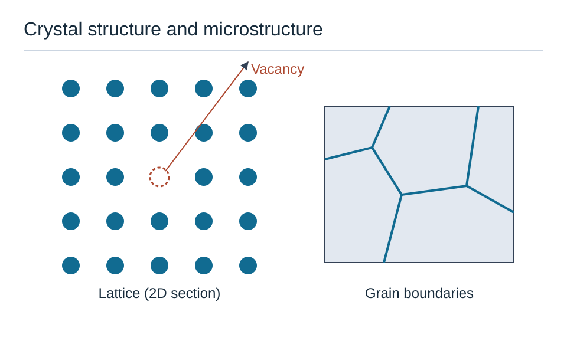

# M4-L1 – Crystal structure and microstructure {#L1}

**Course area:** M4 – Materials and material behaviour

**Level:** Bachelor

**Prerequisites:** [M1-L1 – Units, scaling and dimensional analysis](M1-L1.md)

**Learning objective:** Relate lattice structure, defects and microstructure to material properties.

## Introduction {#S1}

Two components of identical chemical composition may have different hardness and toughness after different processing.

## Foundations, concepts and model {#S2}

Crystalline materials have periodic atomic arrangements; amorphous materials lack corresponding long-range order. Body-centred cubic (BCC) and face-centred cubic (FCC) conventional unit cells contain effectively two and four atoms respectively. The theoretical density is $\rho=nM/(N_Aa^3)$ with atoms per cell n, molar mass M, Avogadro constant and lattice parameter a.

Vacancies, impurities, dislocations and grain boundaries are distinct defect types. Dislocation motion enables plastic deformation. Grain boundaries often impede motion; strength may increase as grain size decreases. Microstructure also includes phase fractions, morphology and orientation. Polycrystals may be anisotropic due to texture.

*Crystal lattice with vacancy and polycrystalline microstructure.*

## Worked example {#S3}

Idealised FCC crystal: M = 0.06355 kg/mol, a = 0.3615 nm, n = 4. With N_A = 6.022·10²³ mol⁻¹, ρ ≈ 8935 kg/m³, consistent with the order of magnitude for copper.

## Self-assessment {#S4}

### Exercises

1. How many atoms does a conventional BCC cell effectively contain?
2. What happens when the cell edge increases at constant cell mass?

::: {.lc-solutions data-lc-section="S4"}
### Solutions

1. 2.
2. Density decreases proportionally to 1/a³.
:::

## Assumptions and limitations {#S5}

The density formula neglects vacancies, porosity and multiple phases. Grain-size effects are not universal over all size ranges.

## Summary and transition {#S6}

Atomic structure and microstructure are starting points for targeted material treatment.

**Continue:** [M4-L2 – Metals and heat treatment](M4-L2.md)

## Sources {#S7}

- [MIT OCW – Point & Line Defects](https://ocw.mit.edu/courses/3-091sc-introduction-to-solid-state-chemistry-fall-2010/pages/crystalline-materials/19-point-and-line-defects/) · Session 19 defects · Last accessed: 2026-11-25
- [MIT OCW – Fundamentals of Materials Science](https://ocw.mit.edu/courses/3-012-fundamentals-of-materials-science-fall-2005/) · Course description: structure, phase transformations, bonding · Last accessed: 2026-11-25

