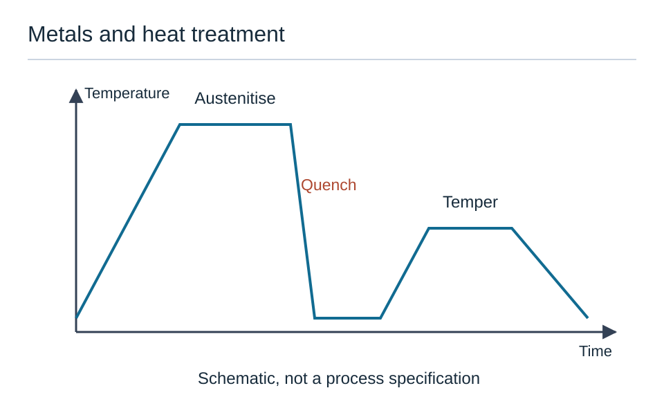

# M4-L2 – Metals and heat treatment {#L2}

**Course area:** M4 – Materials and material behaviour

**Level:** Bachelor

**Prerequisites:** [M4-L1 – Crystal structure and microstructure](M4-L1.md)

**Learning objective:** Explain heat-treatment routes and the role of phase transformations.

## Introduction {#S1}

A shaft needs a wear-resistant surface and a sufficiently tough core. Composition, temperature history and part dimensions must be considered together.

## Foundations, concepts and model {#S2}

Alloys can form different phases depending on composition and temperature. An equilibrium phase diagram describes stable phases, but not the time required for transformation. In steel of suitable composition after austenitising, slow cooling can produce diffusion-controlled microstructures; sufficiently fast cooling may form martensite. Tempering can reduce hardness and improve toughness. Annealing may relieve residual stress or promote recrystallisation.

Precipitation hardening is frequently relevant for aluminium alloys instead: solution treatment, quenching and ageing produce fine precipitates that impede dislocations. Not every metal can be hardened by the same route. An ideal estimate of sensible heat without transformation is Q = mcΔT.

*Schematic temperature history of steel quenching and tempering.*

## Worked example {#S3}

A 2 kg specimen is ideally heated from 20 °C to 800 °C; constant c = 500 J/(kg·K). Q = 2·500·780 = 780 kJ. Furnace losses and transformation enthalpy are excluded.

## Self-assessment {#S4}

### Exercises

1. Why is an equilibrium diagram alone insufficient for quench planning?
2. What is the ideal heat requirement at twice the mass?

::: {.lc-solutions data-lc-section="S4"}
### Solutions

1. It does not contain transformation kinetics.
2. 1560 kJ.
:::

## Assumptions and limitations {#S5}

Not a heat-treatment procedure: actual temperatures, hold times and cooling media depend on material specification, geometry and safety conditions.

## Summary and transition {#S6}

Phase transformation and kinetics determine which properties treatment can achieve.

**Continue:** [M4-L3 – Polymers, ceramics and composites](M4-L3.md)

## Sources {#S7}

- [MIT OCW – Fundamentals of Materials Science](https://ocw.mit.edu/courses/3-012-fundamentals-of-materials-science-fall-2005/) · Course description: structure, phase transformations, bonding · Last accessed: 2026-11-25
- [MIT OCW – Mechanical Behavior of Materials](https://ocw.mit.edu/courses/3-22-mechanical-behavior-of-materials-spring-2008/) · Course description: deformation, creep, fatigue, fracture · Last accessed: 2026-11-25

