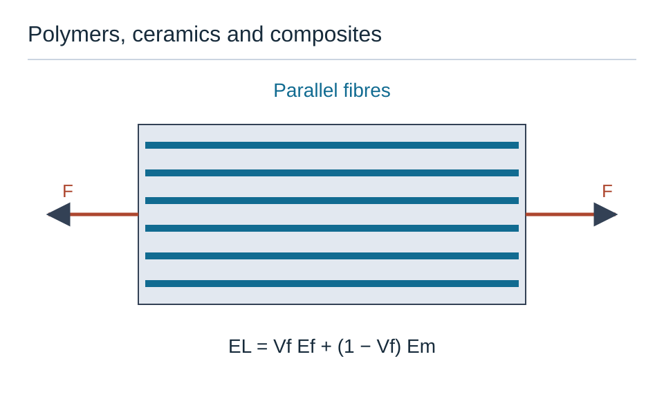

# M4-L3 – Polymers, ceramics and composites {#L3}

**Course area:** M4 – Materials and material behaviour

**Level:** Bachelor

**Prerequisites:** [M4-L2 – Metals and heat treatment](M4-L2.md)

**Learning objective:** Compare material classes and estimate an ideal composite modulus.

## Introduction {#S1}

A lightweight cover, wear-resistant seal and highly loaded beam require different materials.

## Foundations, concepts and model {#S2}

Thermoplastics soften when heated, thermosets have a cross-linked structure and do not melt like thermoplastics. Elastomers permit large reversible strains. Time and temperature strongly affect the mechanical behaviour of many polymers. Ceramics often have high hardness and temperature resistance but are frequently brittle and sensitive to tensile stress and flaws.

In a fibre composite, fibres preferentially carry loads along their direction; the matrix transfers forces between them and protects them. For ideally bonded continuous parallel fibres at equal axial strain, $E_L=V_fE_f+(1-V_f)E_m$. Different relations apply transverse to the fibres. Orientation is therefore part of the material model.

*Fibre composite under tension parallel to the fibres.*

## Worked example {#S3}

Fibre fraction 0.6, fibre modulus 70 GPa, matrix modulus 3 GPa. Longitudinal modulus = 0.6·70 + 0.4·3 = 43.2 GPa. At 0.1% axial strain the mean stress is 43.2 MPa.

## Self-assessment {#S4}

### Exercises

1. What is the longitudinal modulus at 50% fibre fraction?
2. Does the same modulus directly apply transverse to the fibre?

::: {.lc-solutions data-lc-section="S4"}
### Solutions

1. 36.5 GPa.
2. No, orientation and load transfer differ.
:::

## Assumptions and limitations {#S5}

Rule of mixtures only for ideal linear longitudinal loading; no prediction of interface failure, delamination or fatigue.

## Summary and transition {#S6}

Material class and structure determine the choice of a suitable material model.

**Continue:** [M4-L4 – Material testing and properties](M4-L4.md)

## Sources {#S7}

- [MIT OCW – Polymer Engineering](https://ocw.mit.edu/courses/3-064-polymer-engineering-fall-2003/) · Course description: selection, mechanical characterisation, processing · Last accessed: 2026-11-25
- [MIT OCW – Mechanics of Materials: Modules](https://ocw.mit.edu/courses/3-11-mechanics-of-materials-fall-1999/pages/modules/) · Module index: elasticity, composites, stress–strain, fatigue · Last accessed: 2026-11-25

