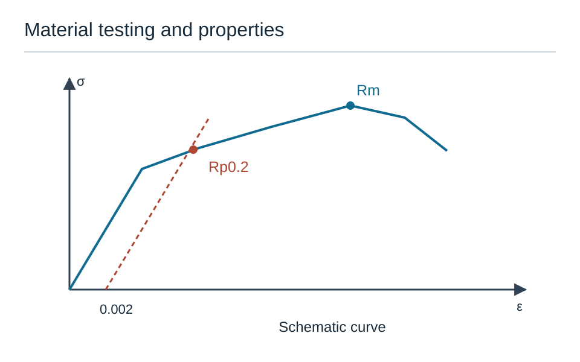

# M4-L4 – Material testing and properties {#L4}

**Course area:** M4 – Materials and material behaviour

**Level:** Bachelor

**Prerequisites:** [M4-L3 – Polymers, ceramics and composites](M4-L3.md)

**Learning objective:** Distinguish tensile-test properties and calculate basic values.

## Introduction {#S1}

A material datasheet lists elastic modulus, proof stress, tensile strength and elongation at fracture. They answer different design questions.

## Foundations, concepts and model {#S2}

A tensile test records force F and extension ΔL. Engineering stress $\sigma=F/A_0$ and engineering strain $\varepsilon=\Delta L/L_0$ refer to the original geometry. Elastic modulus E is the initial slope in the linear elastic region. For materials without a distinct yield point, the 0.2% proof stress is determined using the elastic line offset by 0.002. Tensile strength is the maximum engineering stress; necking may follow.

Hardness measures resistance to local indentation under a defined method, while Charpy impact energy measures energy absorbed in a particular impact test. These test values are not interchangeable without additional assumptions. Record specimen geometry, test temperature and loading rate.

*Schematic engineering stress–strain curve with 0.2% proof stress.*

## Worked example {#S3}

Specimen A₀ = 50 mm², L₀ = 100 mm. At 10 kN and elastic extension 0.1 mm: σ = 200 MPa, ε = 0.001, E = 200 GPa. At a maximum force of 25 kN the tensile strength is 500 MPa.

## Self-assessment {#S4}

### Exercises

1. What engineering stress occurs at 15 kN?
2. Is tensile strength identical to proof stress?

::: {.lc-solutions data-lc-section="S4"}
### Solutions

1. 300 MPa.
2. No; maximum engineering stress and onset of defined permanent strain differ.
:::

## Assumptions and limitations {#S5}

The example is not a test report. Machine compliance, extensometers, standard specimens and measurement uncertainty matter in real tests.

## Summary and transition {#S6}

Properties must match the actual loading mode and tested material condition.

**Continue:** [M4-L5 – Fatigue, fracture and corrosion](M4-L5.md)

## Sources {#S7}

- [MIT OCW – Mechanics of Materials: Modules](https://ocw.mit.edu/courses/3-11-mechanics-of-materials-fall-1999/pages/modules/) · Module index: elasticity, composites, stress–strain, fatigue · Last accessed: 2026-11-25
- [OpenStax – University Physics Volume 1, 12.3 Stress, Strain, and Elastic Modulus](https://openstax.org/books/university-physics-volume-1/pages/12-3-stress-strain-and-elastic-modulus) · §12.3: stress, strain, elastic modulus · Last accessed: 2026-11-25

