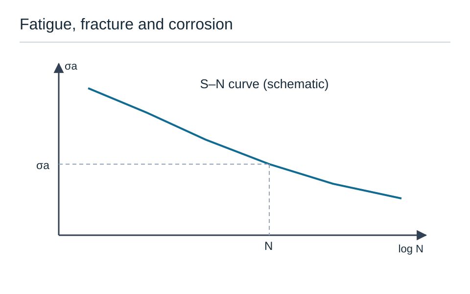

# M4-L5 – Fatigue, fracture and corrosion {#L5}

**Course area:** M4 – Materials and material behaviour

**Level:** Bachelor

**Prerequisites:** [M4-L4 – Material testing and properties](M4-L4.md)

**Learning objective:** Distinguish fatigue, crack growth and corrosion damage.

## Introduction {#S1}

A rotating shaft can fail under repeated bending although its maximum nominal stress stays below static yield.

## Foundations, concepts and model {#S2}

For cyclic loading, stress amplitude $\sigma_a=(\sigma_{max}-\sigma_{min})/2$ and mean stress $\sigma_m=(\sigma_{max}+\sigma_{min})/2$ are important. S–N curves relate tolerable amplitude to cycle count under specified conditions. Notches, surface condition, size and environment influence life.

In linear-elastic fracture mechanics, $K_I=Y\sigma\sqrt{\pi a}$ characterises Mode I crack loading with crack size a and geometry factor Y. Critical values depend on material and boundary conditions. Corrosion is chemical or electrochemical interaction with the environment; pitting can create notches, and corrosion fatigue may shorten life. Protection and inspection complement analytical design.

*Schematic S–N curve with decreasing stress amplitude.*

## Worked example {#S3}

Cycle between −60 and +140 MPa: σₐ = 100 MPa, σₘ = 40 MPa. For a separate idealised crack with a = 2 mm, Y = 1 and tensile stress 100 MPa, K_I ≈ 7.93 MPa√m.

## Self-assessment {#S4}

### Exercises

1. What amplitude occurs for fully reversed loading between −80 and +80 MPa?
2. How does K_I change at four times the crack size with all other model parameters fixed?

::: {.lc-solutions data-lc-section="S4"}
### Solutions

1. 80 MPa.
2. It doubles.
:::

## Assumptions and limitations {#S5}

No approval of an actual component; crack geometry, plasticity, load spectrum and environmental effects require separate evidence.

## Summary and transition {#S6}

Damage mechanisms must be considered in material selection and inspection planning.

**Continue:** [M4-L6 – Materials selection](M4-L6.md)

## Sources {#S7}

- [MIT OCW – Fracture and Fatigue](https://ocw.mit.edu/courses/3-35-fracture-and-fatigue-fall-2003/) · Course description: fatigue, crack growth, corrosion fatigue · Last accessed: 2026-11-25
- [MIT OCW – Mechanical Behavior of Materials](https://ocw.mit.edu/courses/3-22-mechanical-behavior-of-materials-spring-2008/) · Course description: deformation, creep, fatigue, fracture · Last accessed: 2026-11-25

