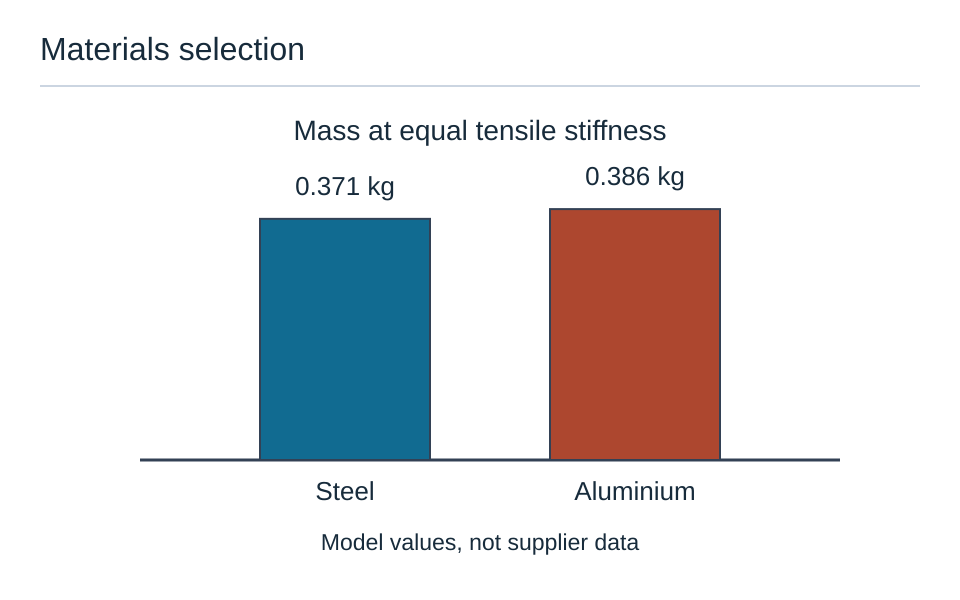

# M4-L6 – Materials selection {#L6}

**Course area:** M4 – Materials and material behaviour

**Level:** Bachelor

**Prerequisites:** [M4-L5 – Fatigue, fracture and corrosion](M4-L5.md)

**Learning objective:** Select materials using requirements, constraints and an appropriate objective.

## Introduction {#S1}

A tensile tie should be as light as possible while satisfying a maximum elastic extension. The cheapest or strongest material is not necessarily optimal.

## Foundations, concepts and model {#S2}

First specify function, constraints, objective and free variables. Hard requirements such as operating temperature or chemical compatibility screen out unsuitable candidates. Remaining candidates can be ranked by a derived objective.

For a tensile tie of length L and force F, $\delta=FL/(EA)$ and mass $m=\rho AL$. If A is freely chosen and allowable extension governs, $A\ge FL/(E\delta_{max})$ and hence $m_{min}=\rho FL^2/(E\delta_{max})$. For the same task a high E/ρ ratio is favourable. Bending, strength or stability constraints yield different indices. Manufacturing, cost, repair and recycling require separate checks afterwards.

*Comparison of density and elastic modulus for two model materials.*

## Worked example {#S3}

Ideal values: steel E = 210 GPa, ρ = 7800 kg/m³; aluminium E = 70 GPa, ρ = 2700 kg/m³. With F = 10 kN, L = 1 m, δ_max = 1 mm, steel requires A = 47.62 mm², m = 0.371 kg; aluminium A = 142.86 mm², m = 0.386 kg. Both are close in this model.

## Self-assessment {#S4}

### Exercises

1. What area does steel require if allowable extension is halved?
2. Why must the derived index not automatically be applied to a beam in bending?

::: {.lc-solutions data-lc-section="S4"}
### Solutions

1. 95.24 mm².
2. Stiffness also depends on second moment of area and cross-sectional shape.
:::

## Assumptions and limitations {#S5}

Ideal values are not guaranteed supplier data. Joint geometry, strength, corrosion, cost and load cycles may change the ranking.

## Summary and transition {#S6}

Materials selection is a verifiable optimisation problem, not merely a table comparison.

**Continue:** [M5-L1 – Systems, state variables and property models](M5-L1.md)

## Sources {#S7}

- [MIT OCW – Electronic and Mechanical Properties of Materials: Readings](https://ocw.mit.edu/courses/3-225-electronic-and-mechanical-properties-of-materials-fall-2007/pages/readings/) · Session 12 materials selection and performance indices · Last accessed: 2026-11-25
- [MIT OCW – Polymer Engineering](https://ocw.mit.edu/courses/3-064-polymer-engineering-fall-2003/) · Course description: selection, mechanical characterisation, processing · Last accessed: 2026-11-25

