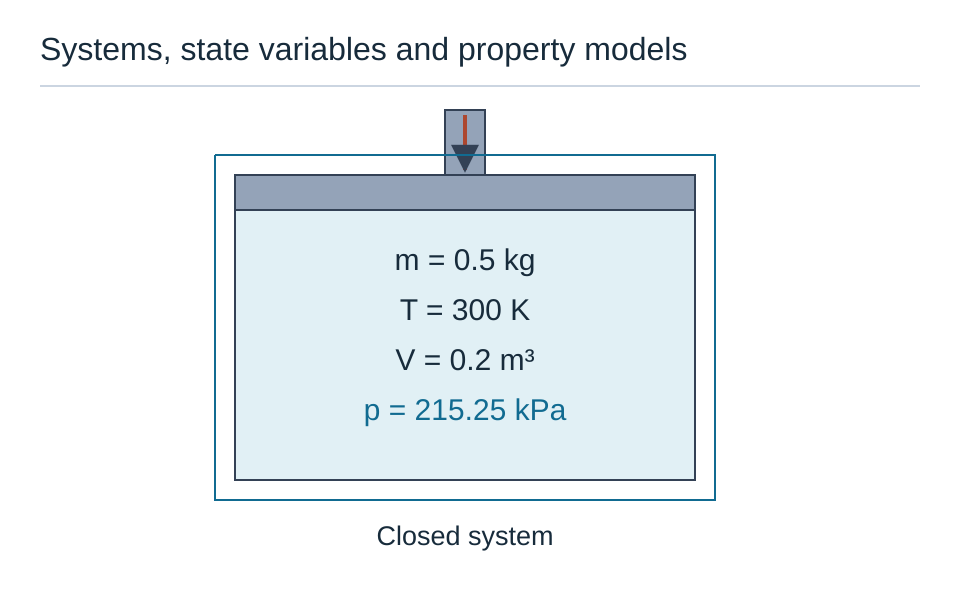

# M5-L1 – Systems, state variables and property models {#L1}

**Course area:** M5 – Thermodynamics

**Level:** Bachelor

**Prerequisites:** [M1-L1 – Units, scaling and dimensional analysis](M1-L1.md)

**Learning objective:** Define system boundaries and calculate ideal gas states.

## Introduction {#S1}

A compressor, pressure vessel and gas in a piston differ in their exchange of matter. Every balance starts by defining the object of study.

## Foundations, concepts and model {#S2}

A closed system has constant mass because no mass crosses the system boundary; an open control volume permits mass exchange. An isolated system exchanges neither mass nor energy. Pressure p, temperature T and volume V describe an equilibrium state; mass and volume are extensive, temperature and pressure intensive. Specific properties are per kilogram, for example $v=V/m$.

An ideal gas obeys $pV=nRT=mR_sT$, with absolute pressure and Kelvin temperature. For air, use approximately $R_s=287\,\mathrm{J/(kg\,K)}$. The compressibility factor $Z=pv/(R_sT)$ quantifies departure from ideal-gas behaviour. Phase changes require property tables or appropriate equations of state.

*Piston-cylinder system with state variables and system boundary.*

## Worked example {#S3}

A closed vessel contains 0.5 kg of air at 300 K and 0.2 m³. p = 0.5 · 287 · 300 / 0.2 = 215,250 Pa = 215.25 kPa absolute. At 100 kPa ambient pressure a gauge sensor reads 115.25 kPa.

## Self-assessment {#S4}

### Exercises

1. How does p change at 600 K and fixed volume?
2. Is a turbine with steady throughflow closed?

::: {.lc-solutions data-lc-section="S4"}
### Solutions

1. It doubles to 430.5 kPa.
2. No, mass crosses the boundary.
:::

## Assumptions and limitations {#S5}

Ideal-gas assumption at moderate density; no condensate or leakage. Use absolute temperatures and pressures.

## Summary and transition {#S6}

The system boundary determines the balance; the property model supplies the states.

**Continue:** [M5-L2 – First law and energy balances](M5-L2.md)

## Sources {#S7}

- [OpenStax – University Physics 2: Chapter 2 Key Equations](https://openstax.org/books/university-physics-volume-2/pages/2-key-equations) · Ideal gas law; equation of state · Last accessed: 2026-11-25
- [Purdue University – ME 200 Thermodynamics I](https://engineering.purdue.edu/ME200/) · Course scope: engineering devices and cycles · Last accessed: 2026-11-25

