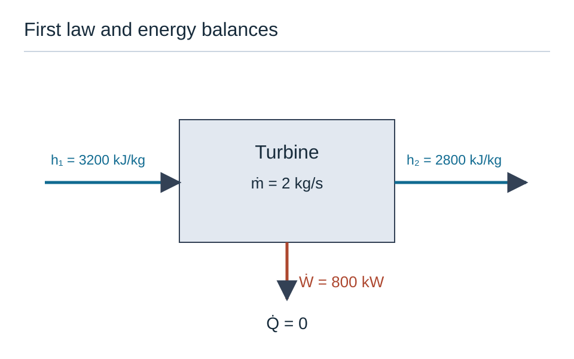

# M5-L2 – First law and energy balances {#L2}

**Course area:** M5 – Thermodynamics

**Level:** Bachelor

**Prerequisites:** [M5-L1 – Systems, state variables and property models](M5-L1.md)

**Learning objective:** Apply the first law to closed and steady-flow open systems.

## Introduction {#S1}

Energy can cross a boundary as heat, work or mass flow. Signs must consistently match the chosen system boundary.

## Foundations, concepts and model {#S2}

Take heat Q into the system and work W out of it as positive. Then $\Delta U+\Delta E_{kin}+\Delta E_{pot}=Q-W$. Internal energy U is a state property; Q and W depend on the process path. For quasi-static volume change, $W_b=\int p\,dV$.

For a steady control volume with one inlet and outlet, $\dot Q-\dot W_s=\dot m[(h_2-h_1)+(c_2^2-c_1^2)/2+g(z_2-z_1)]$. Specific enthalpy $h=u+pv$ includes flow work at the section; shaft work is accounted for separately. The mass balance is also necessary.

*Energy balance of a system and a turbine with throughflow.*

## Worked example {#S3}

An adiabatic turbine processes 2 kg/s. h₁ = 3200 kJ/kg, h₂ = 2800 kJ/kg, with negligible speed and elevation changes. Shaft power = 2 · (3200 − 2800) = 800 kW. With 20 kW heat loss and unchanged enthalpy drop and mass flow, shaft power is 780 kW.

## Self-assessment {#S4}

### Exercises

1. A rigid closed vessel receives 50 kJ of heat with no other work. ΔU?
2. Why is enthalpy useful in a control volume?

::: {.lc-solutions data-lc-section="S4"}
### Solutions

1. 50 kJ if position and speed are unchanged.
2. It combines internal energy and flow work.
:::

## Assumptions and limitations {#S5}

Steady operation and neglected energy terms require justification. Enthalpies here are prescribed model values.

## Summary and transition {#S6}

Energy is conserved even when losses reduce useful work.

**Continue:** [M5-L3 – Entropy and second law](M5-L3.md)

## Sources {#S7}

- [OpenStax – University Physics 2: Chapter 3 Key Equations](https://openstax.org/books/university-physics-volume-2/pages/3-key-equations) · First law and volume work · Last accessed: 2026-11-25
- [Purdue University – ME 200 Thermodynamics I](https://engineering.purdue.edu/ME200/) · Course scope: engineering devices and cycles · Last accessed: 2026-11-25

