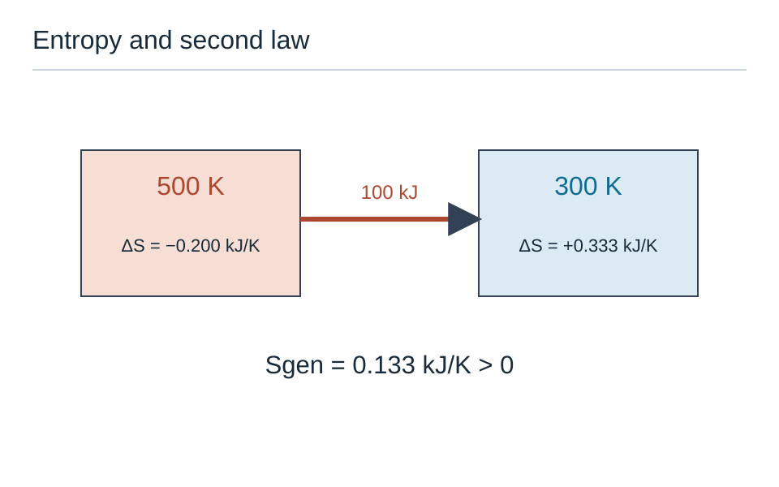

# M5-L3 – Entropy and second law {#L3}

**Course area:** M5 – Thermodynamics

**Level:** Bachelor

**Prerequisites:** [M5-L2 – First law and energy balances](M5-L2.md)

**Learning objective:** Set up entropy balances and identify irreversible processes.

## Introduction {#S1}

An energy balance alone does not explain why heat spontaneously flows from hot to cold. The second law supplies the direction of the process.

## Foundations, concepts and model {#S2}

Entropy S is a state property in J/K. Along a reversible path, $dS=\delta Q_{rev}/T$. For a closed system with heat transfer at boundary temperature $T_b$, the balance is $\Delta S=\int\delta Q/T_b+S_{gen}$ with $S_{gen}\ge0$. Friction, mixing and heat transfer across a finite temperature difference generate entropy.

For an ideal gas with constant specific heat capacities, $\Delta s=c_p\ln(T_2/T_1)-R_s\ln(p_2/p_1)$. A reversible adiabatic process is isentropic; adiabatic alone does not imply isentropic.

*Heat flow from a hot to a cold reservoir and entropy generation.*

## Worked example {#S3}

100 kJ flows from 500 K to 300 K. The hot reservoir loses 0.200 kJ/K, the cold one gains 0.3333 kJ/K. Total: S_gen = 0.1333 kJ/K > 0. Energy is conserved.

## Self-assessment {#S4}

### Exercises

1. What is S_gen for 200 kJ under the same conditions?
2. Can the entropy of one system decrease?

::: {.lc-solutions data-lc-section="S4"}
### Solutions

1. 0.2667 kJ/K.
2. Yes, through entropy export; total entropy of an isolated system does not decrease.
:::

## Assumptions and limitations {#S5}

Reservoir temperatures are constant; all temperatures absolute. Variable c_p requires appropriate integration.

## Summary and transition {#S6}

Entropy generation measures irreversibility, not destruction of energy.

**Continue:** [M5-L4 – Cycles and heat engines](M5-L4.md)

## Sources {#S7}

- [OpenStax – Entropy](https://openstax.org/books/university-physics-volume-2/pages/4-6-entropy) · §4.6 entropy change and second law · Last accessed: 2026-11-25
- [OpenStax – University Physics 2: Chapter 4 Key Equations](https://openstax.org/books/university-physics-volume-2/pages/4-key-equations) · Engine efficiency and coefficients of performance · Last accessed: 2026-11-25

