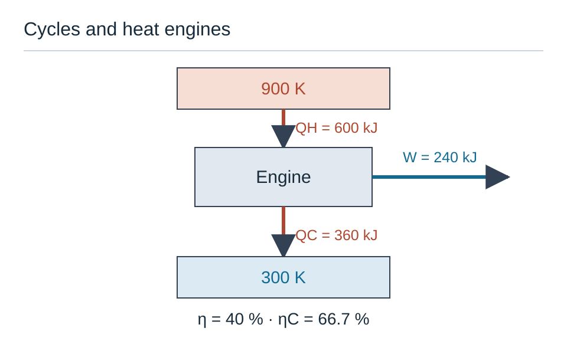

# M5-L4 – Cycles and heat engines {#L4}

**Course area:** M5 – Thermodynamics

**Level:** Bachelor

**Prerequisites:** [M5-L3 – Entropy and second law](M5-L3.md)

**Learning objective:** Balance cycles and compare efficiencies against the Carnot limit.

## Introduction {#S1}

Gas turbines, internal combustion engines and steam plants convert part of thermal energy into mechanical work. The cycle returns to its initial state.

## Foundations, concepts and model {#S2}

In a closed cycle, $\Delta U=0$. Using positive magnitudes of heat added and rejected per cycle, $W_{net}=Q_H-Q_C$ and $\eta=W_{net}/Q_H$. Between two reservoirs the upper bound is $\eta_C=1-T_C/T_H$ (kelvin). Real cycles fall below it.

The ideal Otto cycle uses isentropic compression and expansion with constant-volume heat addition and rejection. The Brayton cycle models gas turbines with constant-pressure heat steps; the Rankine cycle uses a pump, steam generator, turbine and condenser. The enclosed area in a p-V diagram is net boundary work for a quasi-static cycle.

*Heat engine with heat input, useful work and rejected heat.*

## Worked example {#S3}

An engine receives 600 kJ at 900 K and rejects 360 kJ to 300 K. W_net = 240 kJ, η = 40%. Carnot limit = 1 − 300/900 = 66.7%. The stated efficiency does not violate this limit.

## Self-assessment {#S4}

### Exercises

1. What net work would a reversible cycle deliver for the same heat input?
2. Why cannot an engine convert all heat from a single reservoir into work?

::: {.lc-solutions data-lc-section="S4"}
### Solutions

1. 400 kJ.
2. A cyclic process requires entropy rejection under the second law.
:::

## Assumptions and limitations {#S5}

Carnot applies to two reservoir temperatures, not indiscriminately to varying heat sources. Real engines require loss and property models.

## Summary and transition {#S6}

Compare cycles using net work, heat input and thermodynamic bounds.

**Continue:** [M5-L5 – Refrigeration and heat pumps](M5-L5.md)

## Sources {#S7}

- [OpenStax – University Physics 2: Chapter 4 Key Equations](https://openstax.org/books/university-physics-volume-2/pages/4-key-equations) · Engine efficiency and coefficients of performance · Last accessed: 2026-11-25
- [Purdue University – ME 200 Thermodynamics I](https://engineering.purdue.edu/ME200/) · Course scope: engineering devices and cycles · Last accessed: 2026-11-25

