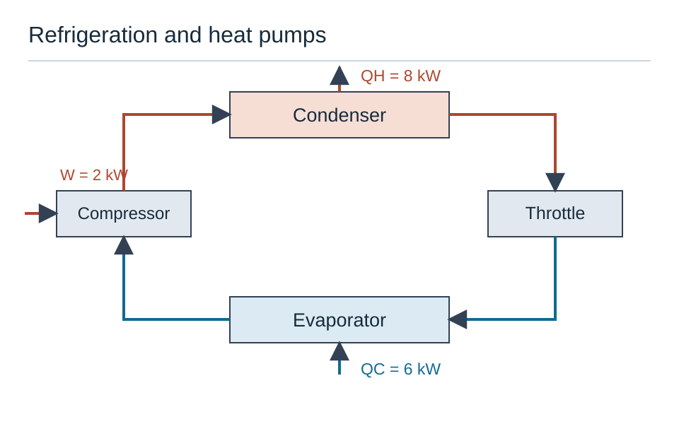

# M5-L5 – Refrigeration and heat pumps {#L5}

**Course area:** M5 – Thermodynamics

**Level:** Bachelor

**Prerequisites:** [M5-L4 – Cycles and heat engines](M5-L4.md)

**Learning objective:** Calculate coefficients of performance and explain vapour compression.

## Introduction {#S1}

Refrigerators and heat pumps consume work to transfer heat against the natural temperature gradient. The useful output depends on which side is considered.

## Foundations, concepts and model {#S2}

Using positive magnitudes, $Q_H=Q_C+W$. Refrigeration performance is $COP_R=Q_C/W$, heating performance is $COP_H=Q_H/W=COP_R+1$. Reversible limits are $COP_{R,C}=T_C/(T_H-T_C)$ and $COP_{H,C}=T_H/(T_H-T_C)$.

In the evaporator, refrigerant absorbs heat; the compressor raises pressure; the condenser rejects heat; the throttle reduces pressure at approximately constant enthalpy. A p-h diagram enables energy balances per kg of refrigerant.

*Refrigeration loop with compressor, condenser, throttle and evaporator.*

## Worked example {#S3}

A heat pump absorbs 6 kW of environmental heat and consumes 2 kW of power. Heating output = 8 kW, COP_H = 4, COP_R = 3. At reservoir temperatures 280 K and 320 K the reversible heating limit is 8.

## Self-assessment {#S4}

### Exercises

1. How much electrical power is needed for 12 kW heat output at COP = 3?
2. Why can COP exceed one?

::: {.lc-solutions data-lc-section="S4"}
### Solutions

1. 4 kW, for the same balance boundary.
2. Heat is transferred from the environment in addition to work input.
:::

## Assumptions and limitations {#S5}

Constant operating conditions; seasonal performance also includes part load, auxiliaries and defrosting. Refrigerant safety requires separate consideration.

## Summary and transition {#S6}

COP measures the desired heat flow per unit of work input.

**Continue:** [M5-L6 – Exergy and irreversible processes](M5-L6.md)

## Sources {#S7}

- [OpenStax – University Physics 2: Chapter 4 Key Equations](https://openstax.org/books/university-physics-volume-2/pages/4-key-equations) · Engine efficiency and coefficients of performance · Last accessed: 2026-11-25
- [Purdue University – ME 200 Thermodynamics I](https://engineering.purdue.edu/ME200/) · Course scope: engineering devices and cycles · Last accessed: 2026-11-25

