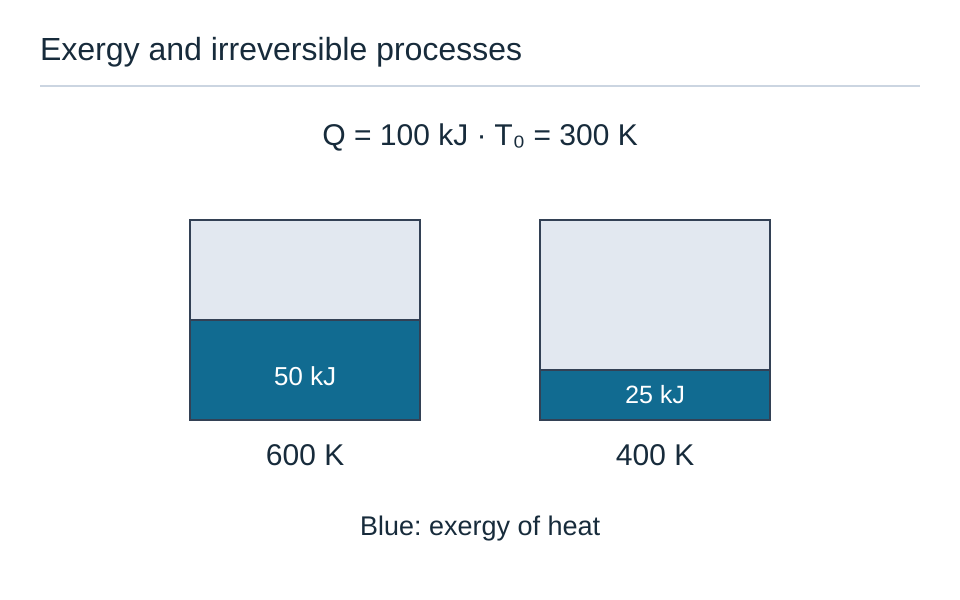

# M5-L6 – Exergy and irreversible processes {#L6}

**Course area:** M5 – Thermodynamics

**Level:** Bachelor

**Prerequisites:** [M5-L5 – Refrigeration and heat pumps](M5-L5.md)

**Learning objective:** Distinguish exergy from energy and calculate exergy destruction.

## Introduction {#S1}

A kilowatt-hour of heat just above ambient temperature contains the same energy as high-temperature heat, but its work potential differs.

## Foundations, concepts and model {#S2}

Exergy is the maximum useful work obtainable during a reversible transition to equilibrium with a defined environment $(T_0,p_0)$. For heat Q transferred from a reservoir at constant temperature T > T₀ (positive when supplied across the system boundary under consideration), the Carnot factor gives $B_Q=Q(1-T_0/T)$.

For irreversibility the Gouy–Stodola relation is $B_{dest}=T_0 S_{gen}$. Unlike energy, exergy is destroyed by irreversible processes. A balance therefore distinguishes exported exergy from internally destroyed exergy; an exergy efficiency must explicitly define the desired product and input.

*Exergy of heat at two temperature levels relative to the environment.*

## Worked example {#S3}

100 kJ of heat at 600 K has a maximum work potential of 50 kJ at T₀ = 300 K; at 400 K only 25 kJ. Transferring the 100 kJ directly from 600 K to 400 K generates S_gen = 100/400 − 100/600 = 0.08333 kJ/K. Exergy destruction = 25 kJ.

## Self-assessment {#S4}

### Exercises

1. How much exergy does heat at T = T₀ have?
2. Is exergy export the same as exergy destruction?

::: {.lc-solutions data-lc-section="S4"}
### Solutions

1. Zero relative to that environment.
2. No. Exported exergy may still be useful outside the boundary.
:::

## Assumptions and limitations {#S5}

Constant environment and reservoir temperatures; chemical exergy and complex mixtures are not accounted for here.

## Summary and transition {#S6}

Exergy analyses locate thermodynamic losses and complement energy balances.

**Continue:** [M6-L1 – Hydrostatics and buoyancy](M6-L1.md)

## Sources {#S7}

- [MIT OCW – Advanced Thermodynamics: Lecture Notes](https://ocw.mit.edu/courses/2-43-advanced-thermodynamics-spring-2024/resources/lecture-notes/) · Lectures 2 and 5: entropy, availability and efficiencies · Last accessed: 2026-11-25
- [OpenStax – Entropy](https://openstax.org/books/university-physics-volume-2/pages/4-6-entropy) · §4.6 entropy change and second law · Last accessed: 2026-11-25
- [OpenStax – University Physics 2: Chapter 4 Key Equations](https://openstax.org/books/university-physics-volume-2/pages/4-key-equations) · Engine efficiency and coefficients of performance · Last accessed: 2026-11-25

