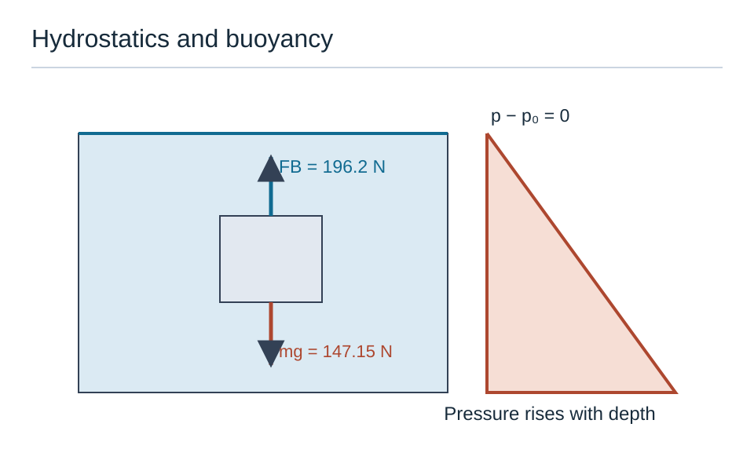

# M6-L1 – Hydrostatics and buoyancy {#L1}

**Course area:** M6 – Fluid mechanics and heat transfer

**Level:** Bachelor

**Prerequisites:** [M1-L1 – Units, scaling and dimensional analysis](M1-L1.md)

**Learning objective:** Determine hydrostatic pressures and buoyancy forces.

## Introduction {#S1}

Tank walls, ships and hydraulic systems are loaded by pressure forces. In stationary liquids, pressure depends on depth.

## Foundations, concepts and model {#S2}

At constant density ρ and upward z-axis, $dp/dz=-\rho g$. At depth h beneath a surface at pressure p₀, $p=p_0+\rho gh$. Gauge pressure is the difference from ambient pressure. With a free surface at ambient pressure it equals ρgh. For a linear pressure distribution on a plane (one-sided loading, consistent pressure reference), $F=p_{centroid} A$; its line of action generally differs from the area centroid for inclined or vertical surfaces.

Integrating pressure over the surface of an immersed body yields buoyancy $F_B=\rho g V_{displaced}$. In static equilibrium freely floating bodies displace a mass of liquid equal to their own mass.

*Hydrostatic pressure profile and buoyancy on a submerged body.*

## Worked example {#S3}

In water with ρ = 1000 kg/m³, gauge pressure at 3 m depth is 29.43 kPa. A fully submerged body displaces 0.020 m³: buoyancy = 196.2 N. For a mass of 15 kg the net force without restraint is 49.05 N upwards.

## Self-assessment {#S4}

### Exercises

1. What gauge pressure occurs at 6 m depth?
2. What volume of water does the freely floating 15 kg body displace?

::: {.lc-solutions data-lc-section="S4"}
### Solutions

1. 58.86 kPa.
2. 0.015 m³.
:::

## Assumptions and limitations {#S5}

Stationary incompressible liquid and constant g. Accelerating vessels and stratification require extended models.

## Summary and transition {#S6}

Pressure increases with depth; buoyancy follows from displaced fluid.

**Continue:** [M6-L2 – Continuity and Bernoulli equation](M6-L2.md)

## Sources {#S7}

- [OpenStax – University Physics 1: Chapter 14 Key Equations](https://openstax.org/books/university-physics-volume-1/pages/14-key-equations) · Hydrostatics, continuity, Bernoulli · Last accessed: 2026-11-25

