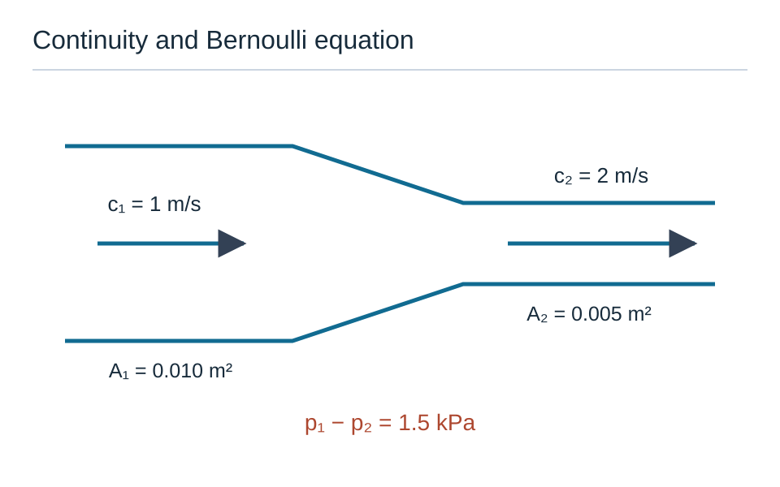

# M6-L2 – Continuity and Bernoulli equation {#L2}

**Course area:** M6 – Fluid mechanics and heat transfer

**Level:** Bachelor

**Prerequisites:** [M6-L1 – Hydrostatics and buoyancy](M6-L1.md)

**Learning objective:** Apply mass and mechanical energy balances to steady flow.

## Introduction {#S1}

In nozzles, pressure energy is converted into kinetic energy. The amount of fluid passing per second follows independently from mass conservation.

## Foundations, concepts and model {#S2}

For steady flow without branches, $\dot m=\rho A\bar c$ is constant. For incompressible flow, volumetric flow $\dot V=A\bar c$ is constant. Along a streamline in steady, inviscid, incompressible flow, $p+\rho c^2/2+\rho gz=\mathrm{const}$. Each term has units of Pa.

Real pipe networks require loss terms and pump work. The simple Bernoulli equation contains no pipe friction losses; cross-section-averaged energy balances may require correction factors for nonuniform profiles.

*Pipe contraction with area, velocity and static pressure.*

## Worked example {#S3}

Water flows horizontally at 1 m/s through A₁ = 0.010 m² and then A₂ = 0.005 m². Flow rate = 0.010 m³/s, c₂ = 2 m/s. Ideally p₁ − p₂ = 1000 · (4 − 1)/2 = 1500 Pa.

## Self-assessment {#S4}

### Exercises

1. What is c₂ when A₂ = A₁/4?
2. Can Bernoulli be applied across a pump without an additional term?

::: {.lc-solutions data-lc-section="S4"}
### Solutions

1. 4 m/s at constant flow rate.
2. No, added mechanical energy must be accounted for.
:::

## Assumptions and limitations {#S5}

No cavitation, compressibility or friction in the ideal example. Absolute static pressure must remain above vapour pressure.

## Summary and transition {#S6}

Continuity gives velocities; Bernoulli gives the ideal pressure relationship.

**Continue:** [M6-L3 – Pipe flow and pressure loss](M6-L3.md)

## Sources {#S7}

- [OpenStax – University Physics 1: Chapter 14 Key Equations](https://openstax.org/books/university-physics-volume-1/pages/14-key-equations) · Hydrostatics, continuity, Bernoulli · Last accessed: 2026-11-25

