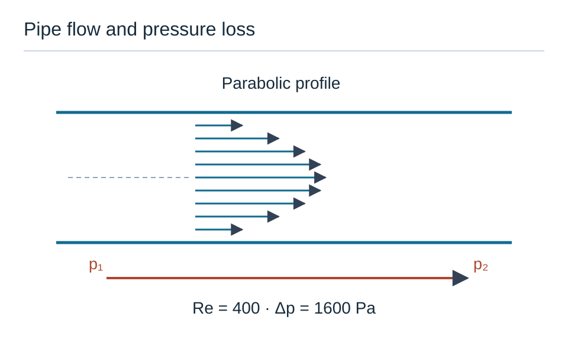

# M6-L3 – Pipe flow and pressure loss {#L3}

**Course area:** M6 – Fluid mechanics and heat transfer

**Level:** Bachelor

**Prerequisites:** [M6-L2 – Continuity and Bernoulli equation](M6-L2.md)

**Learning objective:** Calculate pipe friction losses and interpret Reynolds number.

## Introduction {#S1}

A pipe can lose pressure even at constant elevation and diameter. The cause is viscous dissipation.

## Foundations, concepts and model {#S2}

The Reynolds number $Re=\rho\bar c D/\mu$ compares inertial and viscous effects. Fully developed laminar flow of a Newtonian fluid in a circular pipe obeys Poiseuille's law $\Delta p=32\mu L\bar c/D^2$. This is equivalent to the Darcy–Weisbach equation $\Delta p=f_D(L/D)\rho\bar c^2/2$ with $f_D=64/Re$.

For turbulent flow the Darcy friction factor depends on Re and relative roughness; it is not the Fanning factor, which is four times smaller. Minor losses can be approximated by $\Delta p_{minor}=\sum K\rho\bar c^2/2$ using the appropriate reference velocity.

*Pressure drop in a pipe with a parabolic velocity profile.*

## Worked example {#S3}

A fluid with ρ = 1000 kg/m³, μ = 0.010 Pa·s flows at 0.2 m/s through D = 0.020 m, L = 10 m. Re = 400, f_D = 0.16. Pressure drop = 1600 Pa. Flow rate ≈ 0.00006283 m³/s, hydraulic power ≈ 0.1005 W.

## Self-assessment {#S4}

### Exercises

1. How does laminar pressure loss change at double velocity?
2. Why must the entrance region be considered separately?

::: {.lc-solutions data-lc-section="S4"}
### Solutions

1. It doubles provided flow remains laminar.
2. The velocity profile is not yet fully developed.
:::

## Assumptions and limitations {#S5}

Straight circular pipe, fully developed laminar flow, constant properties. Transitional flow depends on disturbances; minor losses are absent from the example.

## Summary and transition {#S6}

Friction models must match the flow regime and geometry.

**Continue:** [M6-L4 – Boundary layers and turbulence](M6-L4.md)

## Sources {#S7}

- [OpenStax – Viscosity and Turbulence](https://openstax.org/books/university-physics-volume-1/pages/14-7-viscosity-and-turbulence) · §14.7: laminar flow and Poiseuille law · Last accessed: 2026-11-25
- [OpenStax – University Physics 1: Chapter 14 Key Equations](https://openstax.org/books/university-physics-volume-1/pages/14-key-equations) · Hydrostatics, continuity, Bernoulli · Last accessed: 2026-11-25

