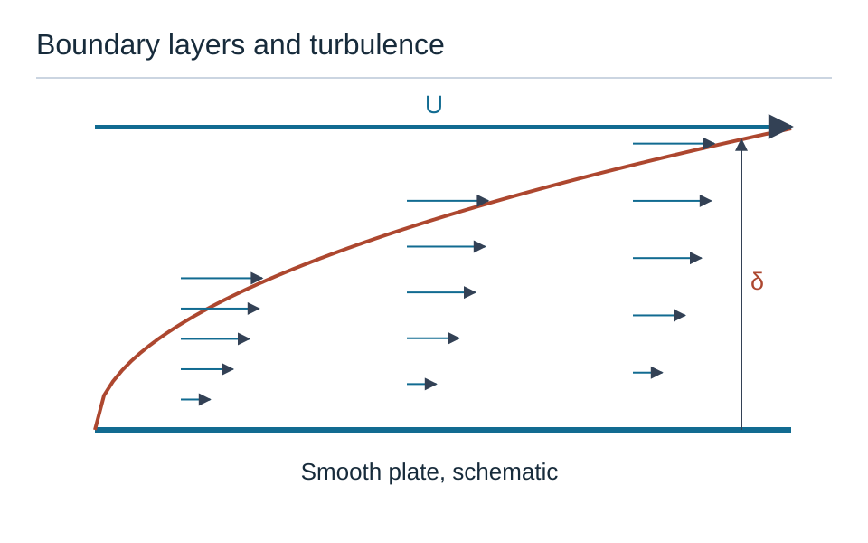

# M6-L4 – Boundary layers and turbulence {#L4}

**Course area:** M6 – Fluid mechanics and heat transfer

**Level:** Bachelor

**Prerequisites:** [M6-L3 – Pipe flow and pressure loss](M6-L3.md)

**Learning objective:** Distinguish boundary layers, wall shear, transition and separation.

## Introduction {#S1}

For a wing or vehicle in a flow, near-wall motion strongly influences drag and heat transfer.

## Foundations, concepts and model {#S2}

For a viscous fluid the no-slip condition $u=0$ approximately applies at a stationary wall. Outside the boundary layer velocity approaches the external flow U. Boundary-layer thickness δ is often defined at $u=0.99U$. For Newtonian fluids wall shear is $\tau_w=\mu(\partial u/\partial y)_w$.

For a laminar Blasius boundary layer on a smooth flat plate without pressure gradient, approximately $\delta\approx5x/\sqrt{Re_x}$ with $Re_x=Ux/\nu$. Turbulent boundary layers have unsteady fluctuations and enhanced momentum transport. An adverse pressure gradient can decelerate near-wall flow and cause separation.

*Growing boundary layer along a plate and velocity profiles.*

## Worked example {#S3}

Air flows at U = 10 m/s over a plate, ν = 1.5·10⁻⁵ m²/s. At x = 0.30 m: Re_x = 200,000, δ ≈ 5 · 0.30 / √200,000 = 3.35 mm, provided the boundary layer is laminar.

## Self-assessment {#S4}

### Exercises

1. How does δ scale with x in the laminar model?
2. Why is there no universal transition point?

::: {.lc-solutions data-lc-section="S4"}
### Solutions

1. With the square root of x at constant U and ν.
2. Roughness, pressure gradient and external disturbances influence transition.
:::

## Assumptions and limitations {#S5}

Blasius applies only to laminar incompressible flow on a smooth plate without pressure gradient. Do not transfer it directly to separated flow.

## Summary and transition {#S6}

Near-wall flow links viscosity to overall drag and heat transfer.

**Continue:** [M6-L5 – Conduction, convection and radiation](M6-L5.md)

## Sources {#S7}

- [MIT OCW – Transport Phenomena in Materials Engineering: Flow Past a Flat Plate](https://ocw.mit.edu/courses/3-185-transport-phenomena-in-materials-engineering-fall-2003/a55c74dc21def01fc0054de35574d1e5_3_21.pdf) · §3.2.1 and §3.2.3, equations (75)–(80), (84)–(86): no slip, laminar Blasius thickness and wall shear; transition and separation treated separately · Last accessed: 2026-11-25 · Content verified: 2026-11-25
- [MIT OCW – Boundary Layers, Separation, and Drag](https://ocw.mit.edu/courses/2-25-advanced-fluid-mechanics-fall-2013/pages/boundary-layers-separation-and-drag/) · Blasius solution reading list · Last accessed: 2026-11-25
- [OpenStax – Viscosity and Turbulence](https://openstax.org/books/university-physics-volume-1/pages/14-7-viscosity-and-turbulence) · §14.7: laminar flow and Poiseuille law · Last accessed: 2026-11-25

