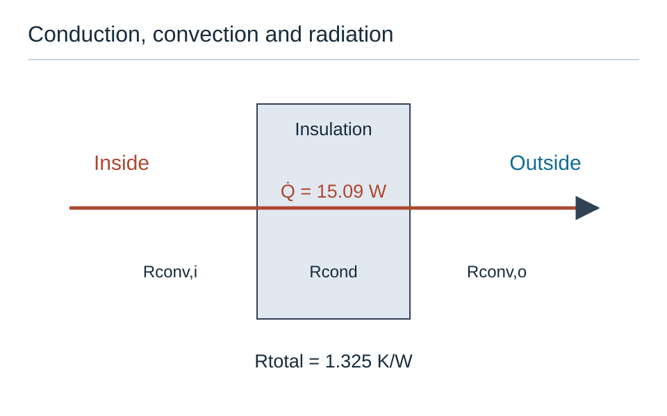

# M6-L5 – Conduction, convection and radiation {#L5}

**Course area:** M6 – Fluid mechanics and heat transfer

**Level:** Bachelor

**Prerequisites:** [M6-L4 – Boundary layers and turbulence](M6-L4.md)

**Learning objective:** Combine thermal resistances and account for radiation separately.

## Introduction {#S1}

Several transport mechanisms act simultaneously in an insulated wall. Resistance models make steady heat flow calculable.

## Foundations, concepts and model {#S2}

For one-dimensional steady conduction, $\dot Q=kA(T_1-T_2)/L$. Conduction resistance is $R_{cond}=L/(kA)$. Convection is described by $\dot Q=hA(T_s-T_\infty)$ and $R_{conv}=1/(hA)$. Series resistances add; at constant steady heat rate, $\dot Q=\Delta T/\sum R$.

A small diffuse-grey surface in a large isothermal enclosure (unit view factor to the enclosure, irradiation approximated by blackbody emissive power at the enclosure temperature) exchanges approximately $\dot Q_{rad}=\epsilon\sigma A(T_s^4-T_{sur}^4)$ net. Here $\sigma\approx5.67\cdot10^{-8}\,\mathrm{W/(m^2K^4)}$. Radiation and convection at the same surface act in parallel; radiation is temperature-dependent.

*Conduction through a wall and convection at both surfaces.*

## Worked example {#S3}

A = 2 m², L = 0.10 m, k = 0.04 W/(m K), internal h = 10, external h = 20 W/(m² K). Resistances: 1.25 + 0.05 + 0.025 = 1.325 K/W. At 20 K difference, heat rate is 15.09 W without radiation.

## Self-assessment {#S4}

### Exercises

1. What conduction resistance results at twice the thickness?
2. Why does the radiation law require kelvin?

::: {.lc-solutions data-lc-section="S4"}
### Solutions

1. 2.5 K/W.
2. The fourth power refers to absolute temperature.
:::

## Assumptions and limitations {#S5}

Steady, one-dimensional, constant properties, no thermal bridges. h depends on geometry, flow and properties.

## Summary and transition {#S6}

Resistances simplify thermal balances; radiation remains nonlinear unless linearised.

**Continue:** [M6-L6 – Heat exchangers](M6-L6.md)

## Sources {#S7}

- [OpenStax – Mechanisms of Heat Transfer](https://openstax.org/books/university-physics-volume-2/pages/1-6-mechanisms-of-heat-transfer) · §1.6 conduction, convection, radiation · Last accessed: 2026-11-25

