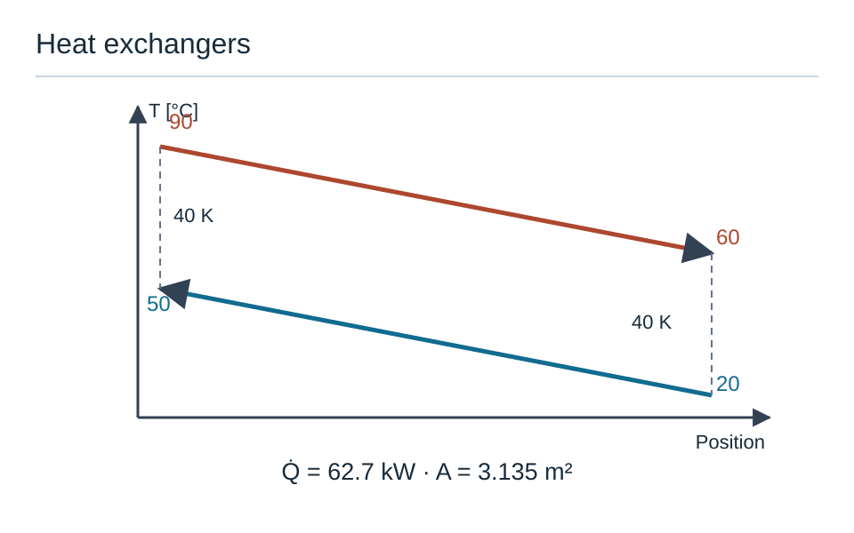

# M6-L6 – Heat exchangers {#L6}

**Course area:** M6 – Fluid mechanics and heat transfer

**Level:** Bachelor

**Prerequisites:** [M6-L5 – Conduction, convection and radiation](M6-L5.md)

**Learning objective:** Size heat exchangers using energy balance and logarithmic temperature difference.

## Introduction {#S1}

Heat exchangers enable energy transfer between fluid streams without directly mixing them. The driving temperature difference varies along the device.

## Foundations, concepts and model {#S2}

With no heat loss to the surroundings and constant heat capacities, $\dot Q=\dot m_h c_{p,h}(T_{h,in}-T_{h,out})=\dot m_c c_{p,c}(T_{c,out}-T_{c,in})$. For ideal counterflow or parallel flow with constant overall heat transfer coefficient U, $\dot Q=UA\Delta T_{lm}$, where $\Delta T_{lm}=(\Delta T_1-\Delta T_2)/\ln(\Delta T_1/\Delta T_2)$ and equal terminal differences use their common value.

In counterflow the terminal differences are $T_{h,in}-T_{c,out}$ and $T_{h,out}-T_{c,in}$. In parallel flow both inlets are at the same end. When outlet temperatures are unknown, the effectiveness–NTU method provides an alternative calculation.

*Counterflow heat exchanger with temperature profiles and terminal differences.*

## Worked example {#S3}

Hot stream: 90 → 60°C, cold stream: 20 → 50°C, both 0.5 kg/s water with c_p = 4180 J/(kg K). Heat rate = 62.7 kW. Counterflow: both terminal differences = 40 K. With U = 500 W/(m² K), A = 62,700/(500·40) = 3.135 m².

## Self-assessment {#S4}

### Exercises

1. What would A be at half U with other data unchanged?
2. What happens if one terminal difference approaches zero while the other remains positive?

::: {.lc-solutions data-lc-section="S4"}
### Solutions

1. 6.27 m².
2. The log mean approaches zero; the area required for fixed heat duty grows without bound in the ideal model.
:::

## Assumptions and limitations {#S5}

Steady counterflow, constant U and c_p, no phase change or external heat loss. Evaluate fouling and pressure loss separately.

## Summary and transition {#S6}

Energy balance fixes heat duty; temperature difference and U determine area.

**Continue:** [M7-L1 – Requirements and functional structure](M7-L1.md)

## Sources {#S7}

- [MIT OCW – Introduction to Engineering Heat Transfer](https://live.ocw.mit.edu/courses/16-050-thermal-energy-fall-2002/87d9f4544b7fd64a77201382500d057c_10_part3.pdf) · Chapter 8, HT-50–51: heat balance and logarithmic mean temperature difference in counterflow · Last accessed: 2026-11-25 · Content verified: 2026-11-25
- [OpenStax – Mechanisms of Heat Transfer](https://openstax.org/books/university-physics-volume-2/pages/1-6-mechanisms-of-heat-transfer) · §1.6 conduction, convection, radiation · Last accessed: 2026-11-25

