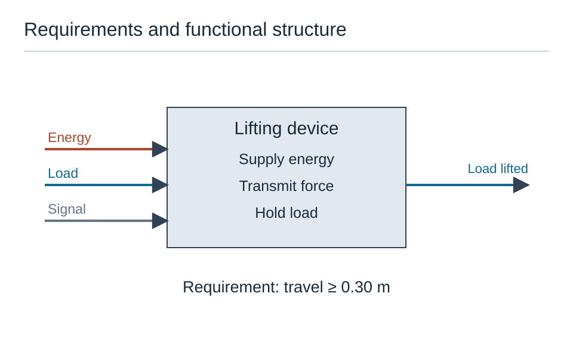

# M7-L1 – Requirements and functional structure {#L1}

**Course area:** M7 – Engineering design and CAD

**Level:** Bachelor

**Prerequisites:** [M1-L1 – Units, scaling and dimensional analysis](M1-L1.md)

**Learning objective:** Formulate measurable requirements and distinguish functions from solution principles.

## Introduction {#S1}

A design begins not with a drawing but with a traceable problem. A lifting device requires clarification of payload, travel, operation, life and safety.

## Foundations, concepts and model {#S2}

A requirement describes a verifiable property. Mandatory requirements constrain the feasible design space; preferences may be weighted. Each requirement should have a unit or test criterion, a limit and a planned verification method. The function states what must be achieved; a screw, rope drive and hydraulic cylinder are different working principles for lifting.

A functional structure decomposes the main function into subfunctions such as supplying energy, transmitting force, holding the load and limiting travel. Material, energy and signal flows reveal interfaces. Only then are working principles combined. A weighted score $S_j=\sum_i w_i r_{ij}$ with $\sum_i w_i=1$ can compare feasible concepts when all ratings use the same scale and higher scores consistently denote the preferred outcome (including cost and mass). Failure of a mandatory requirement cannot be offset by high scores elsewhere.

*Functional structure of a lifting device with energy, material and signal flows.*

## Worked example {#S3}

Two already feasible options receive weights of 0.4/0.35/0.25 for cost, maintenance and mass. A scores 4/3/2 and B scores 3/4/4 out of five. A: 1.6+1.05+0.5=3.15. B: 1.2+1.4+1.0=3.60. B is preferred; sensitivity analysis tests dependence on the weights.

## Self-assessment {#S4}

### Exercises

1. Can low cost substitute for required overload protection?
2. Formulate a testable travel requirement.

::: {.lc-solutions data-lc-section="S4"}
### Solutions

1. No, a mandatory safety requirement must be satisfied.
2. Example: travel at least 0.30 m under a specified payload, measured with a position sensor.
:::

## Assumptions and limitations {#S5}

Scales and weights represent modelled preferences; legal requirements and risk assessments must be checked separately.

## Summary and transition {#S6}

Functions are solution-neutral; requirements establish the basis for subsequent verification.

**Continue:** [M7-L2 – Technical drawings and dimensioning](M7-L2.md)

## Sources {#S7}

- [MIT OCW – D-Lab II: Design Packet](https://ocw.mit.edu/courses/ec-720j-d-lab-ii-design-spring-2010/pages/projects/intro/) · Design stages and documentation · Last accessed: 2026-11-25
- [MIT OCW – Mechanical Assembly and Its Role in Product Development](https://ocw.mit.edu/courses/2-875-mechanical-assembly-and-its-role-in-product-development-fall-2004/) · Course description: mating, constraint, tolerances and assembly · Last accessed: 2026-11-25

