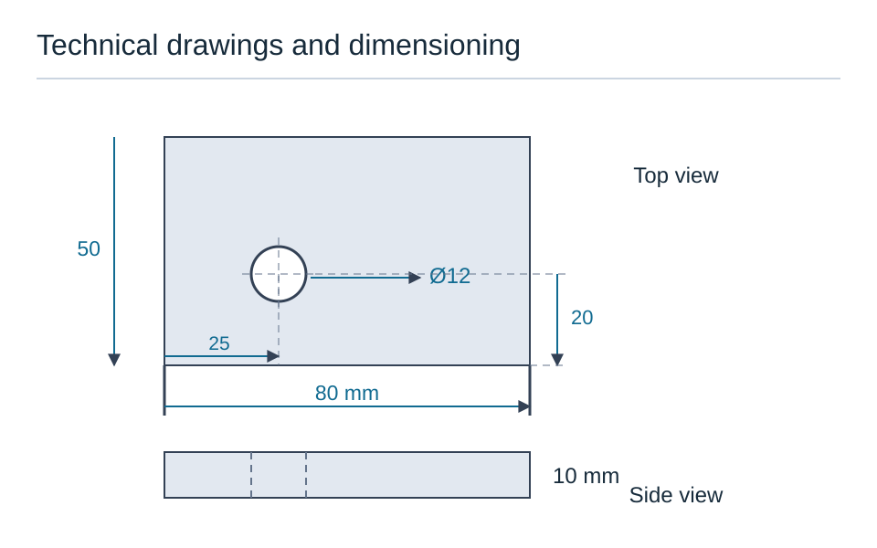

# M7-L2 – Technical drawings and dimensioning {#L2}

**Course area:** M7 – Engineering design and CAD

**Level:** Bachelor

**Prerequisites:** [M7-L1 – Requirements and functional structure](M7-L1.md)

**Learning objective:** Read and create views, sections and function-oriented dimensions.

## Introduction {#S1}

An engineering drawing communicates not just shape but also the requirements of a part to be manufactured and inspected.

## Foundations, concepts and model {#S2}

Orthographic projections represent an object from perpendicular viewing directions. Front, side and top views must depict the same features consistently. Sections reveal interior geometry and distinguish cut material from voids. View arrangement depends on the specified projection convention. A perspective view may improve readability but cannot replace unambiguous manufacturing information.

Dimension lines, extension lines, diameter and radius indications specify nominal geometry. Functional dimensions refer where possible to relevant datum surfaces. Chained dimensions accumulate deviations; baseline dimensioning can avoid this coupling. Drawings also require consistent units, material information, toleranced features and a revision identifier. Read the stated dimensions rather than measuring a printed drawing.

*Orthographic views of a plate with a hole and baseline dimensions.*

## Worked example {#S3}

A plate is 80 mm long, 50 mm wide and 10 mm thick. The centre of a through-hole Ø12 is 25 mm from the left and 20 mm from the bottom. The minimum nominal edge ligament is min(25−6, 80−25−6, 20−6, 50−20−6)=14 mm. Tolerance analysis is separate.

## Self-assessment {#S4}

### Exercises

1. How can thickness be specified in a single top view?
2. Why should the same dimension not be independently toleranced more than once?

::: {.lc-solutions data-lc-section="S4"}
### Solutions

1. By an explicit thickness specification, or an additional view or section.
2. Conflicting nominal or limit dimensions may make manufacturing and inspection ambiguous.
:::

## Assumptions and limitations {#S5}

Educational drawing, not a standards-compliant production release; applicable projection, GPS/GD&T and drawing standards must be identified before use.

## Summary and transition {#S6}

An unambiguous dimensional reference connects function with manufacturing and inspection.

**Continue:** [M7-L3 – Tolerances and fits](M7-L3.md)

## Sources {#S7}

- [MIT OCW – Engineering Drawing and Sketching](https://ocw.mit.edu/courses/2-007-design-and-manufacturing-i-spring-2009/pages/related-resources/drawing_and_sketching/) · Orthographic views, dimensioning and assembly drawings · Last accessed: 2026-11-25
- [MIT OCW – Mechanical Assembly and Its Role in Product Development](https://ocw.mit.edu/courses/2-875-mechanical-assembly-and-its-role-in-product-development-fall-2004/) · Course description: mating, constraint, tolerances and assembly · Last accessed: 2026-11-25

