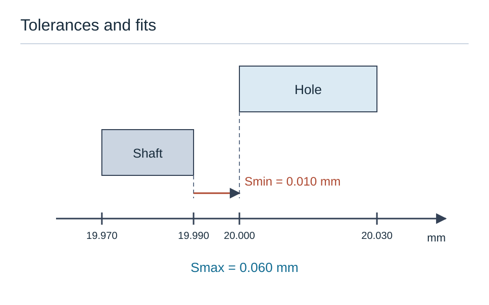

# M7-L3 – Tolerances and fits {#L3}

**Course area:** M7 – Engineering design and CAD

**Level:** Bachelor

**Prerequisites:** [M7-L2 – Technical drawings and dimensioning](M7-L2.md)

**Learning objective:** Calculate limit sizes, clearance, interference and worst-case tolerance stacks.

## Introduction {#S1}

Two parts of identical nominal size may assemble differently because of manufacturing variation. A fit is therefore described using limit sizes.

## Foundations, concepts and model {#S2}

With lower limit $D_{min}$ and upper limit $D_{max}$, size tolerance is $T_D=D_{max}-D_{min}$. For a hole D and shaft d, $S_{min}=D_{min}-d_{max}$ and $S_{max}=D_{max}-d_{min}$. Positive values denote clearance and negative values interference. Two positive values indicate a clearance fit, two negative values an interference fit, and a sign change a transition fit. Zero is a boundary case.

For a linear dimension chain $y=\sum_i a_i x_i$ with symmetric individual tolerances $\pm t_i$, the guaranteed worst-case half-width is $t_y=\sum_i |a_i|t_i$. Statistical models can give less conservative predictions under justified distribution and independence assumptions, but do not replace guaranteed limits. Geometrical tolerances, surfaces and temperature also affect actual assembly.

*Limit-size ranges for hole and shaft showing minimum and maximum clearance.*

## Worked example {#S3}

Hole 20.000–20.030 mm, shaft 19.970–19.990 mm: S_min=0.010 mm, S_max=0.060 mm. For gap y=A−B−C with A=100±0.10 mm, B=40±0.05 mm and C=59±0.08 mm, y=1±0.23 mm; minimum 0.77 mm.

## Self-assessment {#S4}

### Exercises

1. Hole 20.00–20.02 mm; shaft 20.01–20.03 mm. What fit type?
2. What happens if all individual tolerances double?

::: {.lc-solutions data-lc-section="S4"}
### Solutions

1. Transition fit: −0.03 to +0.01 mm.
2. The worst-case half-width doubles to 0.46 mm.
:::

## Assumptions and limitations {#S5}

Limits are educational values, not taken from an ISO fit table. Check current standards and operating conditions for actual selection.

## Summary and transition {#S6}

Function-oriented limits ensure assemblability and avoid unnecessarily tight tolerances.

**Continue:** [M7-L4 – Parametric CAD and assemblies](M7-L4.md)

## Sources {#S7}

- [NISTIR 5615 – Design, specification and tolerancing of micrometer-tolerance assemblies](https://nvlpubs.nist.gov/nistpubs/Legacy/IR/nistir5615.pdf) · Appendix A, pp. 21–22: minimum and maximum clearance and fit sign classes; tolerance stack-up derived separately · Last accessed: 2026-11-25 · Content verified: 2026-11-25
- [MIT OCW – Mechanical Assembly and Its Role in Product Development](https://ocw.mit.edu/courses/2-875-mechanical-assembly-and-its-role-in-product-development-fall-2004/) · Course description: mating, constraint, tolerances and assembly · Last accessed: 2026-11-25

