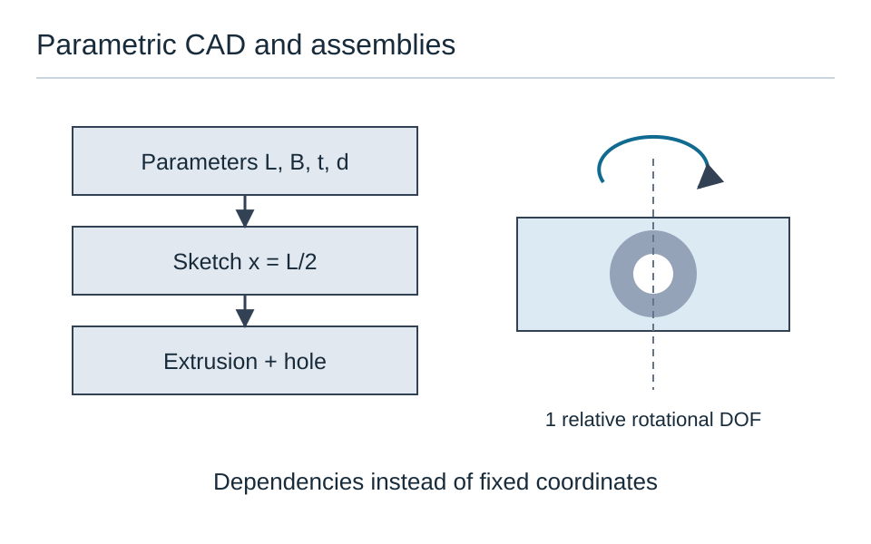

# M7-L4 – Parametric CAD and assemblies {#L4}

**Course area:** M7 – Engineering design and CAD

**Level:** Bachelor

**Prerequisites:** [M7-L3 – Tolerances and fits](M7-L3.md)

**Learning objective:** Construct traceable parametric models and assembly relationships.

## Introduction {#S1}

A CAD model is a geometrical model with relationships. It should retain its intended function after changes, not merely look correct initially.

## Foundations, concepts and model {#S2}

Parametric modelling specifies dimensions and geometrical relationships in a sketch. A feature such as an extrusion or hole uses that geometry as input; subsequent features depend on earlier ones. Meaningful parameter names, stable reference planes and documented dependencies make changes reproducible. A fully constrained sketch has no remaining degrees of freedom.

A free rigid body in three dimensions has six degrees of freedom: three translations and three rotations. An ideal revolute joint between two bodies leaves exactly one relative rotation free. The number of independent constraints must match the intended motion; redundant or conflicting constraints can hinder the solution. CAD interference checking checks geometry, not automatically load capacity or tolerance robustness.

*Parametric dependency tree and remaining rotational freedom of an assembly.*

## Worked example {#S3}

A plate with L=80 mm, B=50 mm, t=10 mm and central hole d=12 mm uses parameters x=L/2 and y=B/2. Volume is V=t(LB−πd²/4)=38,869.03 mm³. After changing L to 100 mm the hole lies at x=50 mm and V=48,869.03 mm³.

## Self-assessment {#S4}

### Exercises

1. How many independent degrees of freedom are removed by an ideal revolute joint?
2. Why should the hole not be centred with a fixed x-coordinate?

::: {.lc-solutions data-lc-section="S4"}
### Solutions

1. Five, relative to the two bodies.
2. A change in length would break centring; x=L/2 preserves it.
:::

## Assumptions and limitations {#S5}

Ideal rigid parts; no elastic deformation, manufacturing tolerances or software-specific solver cases.

## Summary and transition {#S6}

Model parameters document design intent; assembly constraints document intended mobility.

**Continue:** [M7-L5 – Design rules and life cycle](M7-L5.md)

## Sources {#S7}

- [FreeCAD – Parametric objects](https://github.com/FreeCAD/FreeCAD-documentation/blob/main/wiki/Manual_Parametric_objects.md) · Parametric dependencies and model properties · Last accessed: 2026-11-25
- [MIT OCW – Mechanical Assembly and Its Role in Product Development](https://ocw.mit.edu/courses/2-875-mechanical-assembly-and-its-role-in-product-development-fall-2004/) · Course description: mating, constraint, tolerances and assembly · Last accessed: 2026-11-25

