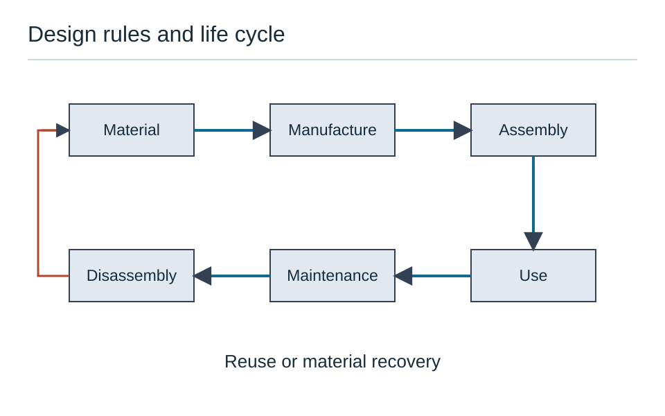

# M7-L5 – Design rules and life cycle {#L5}

**Course area:** M7 – Engineering design and CAD

**Level:** Bachelor

**Prerequisites:** [M7-L4 – Parametric CAD and assemblies](M7-L4.md)

**Learning objective:** Evaluate design for manufacturing, assembly, maintenance and life cycle.

## Introduction {#S1}

A light part is not automatically economical or sustainable. Performance over the intended service life is decisive.

## Foundations, concepts and model {#S2}

Design for manufacturing avoids unnecessary tool changes, inaccessible surfaces and unjustified precision. Design for assembly reduces mix-up risks, facilitates positioning and specifies accessible connections. Design for maintenance considers access, replaceable wear parts and safe shutdown. Disassembly and material separation should be considered at concept stage.

A life-cycle comparison needs a functional unit, identical boundaries and traceable assumptions. A simplified cost calculation can add purchase, energy, maintenance and disposal; over longer periods present value $C=C_0+\sum_{t=1}^{N}C_t/(1+r)^t$ accounts for discount rate r. Environmental impacts are separate measures, not automatically represented by monetary costs.

*Life cycle from material selection to disassembly and reuse.*

## Worked example {#S3}

A costs €1,000, with annual energy and maintenance of €300; B costs €1,400, with annual costs of €180. Over five years, with no discounting and equal end costs: A=€2,500, B=€2,300. B’s extra cost pays back after 400/120=3.33 years.

## Self-assessment {#S4}

### Exercises

1. Which option is cheaper after two years?
2. Does the cost comparison establish lower environmental impact for B?

::: {.lc-solutions data-lc-section="S4"}
### Solutions

1. A: €1,600 versus €1,760 for B.
2. No; separate indicators and life-cycle data are required.
:::

## Assumptions and limitations {#S5}

Hypothetical costs, not a complete LCA model. Add risks, downtime, resources and actual duty profiles.

## Summary and transition {#S6}

Engineering design connects technical function with manufacture and the entire service life.

**Continue:** [M8-L1 – Shafts and axles](M8-L1.md)

## Sources {#S7}

- [MIT OCW – Mechanical Assembly and Its Role in Product Development](https://ocw.mit.edu/courses/2-875-mechanical-assembly-and-its-role-in-product-development-fall-2004/) · Course description: mating, constraint, tolerances and assembly · Last accessed: 2026-11-25
- [MIT OCW – D-Lab II: Design Packet](https://ocw.mit.edu/courses/ec-720j-d-lab-ii-design-spring-2010/pages/projects/intro/) · Design stages and documentation · Last accessed: 2026-11-25

