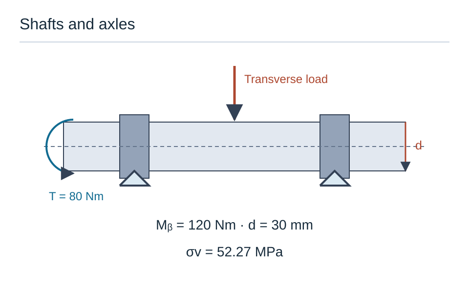

# M8-L1 – Shafts and axles {#L1}

**Course area:** M8 – Machine elements

**Level:** Bachelor

**Prerequisites:** [M1-L1 – Units, scaling and dimensional analysis](M1-L1.md)

**Learning objective:** Distinguish shafts and axles and calculate nominal combined stresses.

## Introduction {#S1}

Shafts transmit torque, while axles primarily support rotating components and, in this idealised distinction, do not transmit useful torque. Both may experience bending.

## Foundations, concepts and model {#S2}

For a solid round shaft of diameter d, nominal outer-fibre stresses under bending and torsion are $\sigma_b=32M_b/(\pi d^3)$ and $\tau_t=16T/(\pi d^3)$. Under simultaneous bending normal stress and torsional shear, the von Mises equivalent stress $\sigma_v=\sqrt{\sigma_b^2+3\tau_t^2}$ is a static yield criterion for ductile materials. Shoulders, grooves and holes affect local stress.

Rotational power is $P=T\omega$, with $\omega=2\pi n/60$ for speed n in rpm. Beyond strength, a shaft often must meet stiffness, fatigue, bearing alignment and critical-speed requirements. A material point on a rotating shaft under a spatially fixed transverse force may experience alternating bending stress.

*Shaft with bearing positions, bending moment and torque.*

## Worked example {#S3}

d=30 mm, M_b=120 Nm, T=80 Nm. Using Nmm: σ_b=45.27 MPa, τ_t=15.09 MPa; σ_v=52.27 MPa. At n=1500 rpm, P=12.57 kW.

## Self-assessment {#S4}

### Exercises

1. How do nominal stresses change at d=60 mm?
2. Does passing a static von Mises check establish fatigue strength?

::: {.lc-solutions data-lc-section="S4"}
### Solutions

1. They fall to one eighth at unchanged moments.
2. No; load cycles, mean stress, notches and material data must be evaluated separately.
:::

## Assumptions and limitations {#S5}

Smooth solid section, linear elasticity, no additional axial forces; not a design verification for an actual drive.

## Summary and transition {#S6}

Moment balance supplies the loading; geometry determines nominal stress.

**Continue:** [M8-L2 – Bolts and joints](M8-L2.md)

## Sources {#S7}

- [MIT OCW – Elements of Mechanical Design: Lecture Notes](https://ocw.mit.edu/courses/2-72-elements-of-mechanical-design-spring-2009/pages/lecture-notes/) · Lecture index: shafts, bearings, bolted joints, gears, clutches and brakes; PDFs not individually reviewed · Last accessed: 2026-11-25
- [MIT OCW – Mechanics of Materials (Fall 1999)](https://ocw.mit.edu/courses/3-11-mechanics-of-materials-fall-1999/) · Course Description; Spannung/Dehnung, Fachwerk, Torsion, Biegung; weiterführende Einzeltexte offen · Last accessed: 2026-11-25
- [OpenStax – University Physics 1: Work and Power for Rotational Motion](https://openstax.org/books/university-physics-volume-1/pages/10-8-work-and-power-for-rotational-motion) · §10.8 torque, work and power · Last accessed: 2026-11-25

