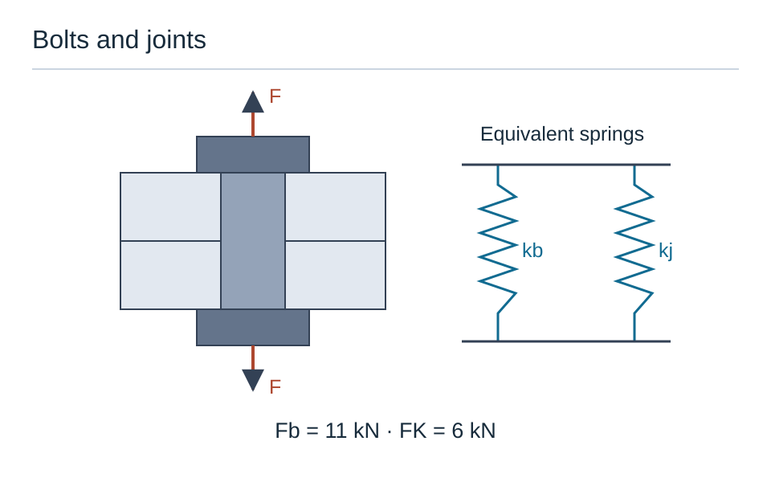

# M8-L2 – Bolts and joints {#L2}

**Course area:** M8 – Machine elements

**Level:** Bachelor

**Prerequisites:** [M8-L1 – Shafts and axles](M8-L1.md)

**Learning objective:** Determine preload, load sharing and remaining clamp force using a simplified spring model.

## Introduction {#S1}

Bolts join parts detachably. Preload holds mating faces together and influences loading under external tension.

## Foundations, concepts and model {#S2}

Assembly creates bolt tension $F_V$ and an equal clamp force. For the idealised axial case with loading at the outer clamp faces, let bolt stiffness $k_b$ and member stiffness $k_j$ be given. Load fraction $\Phi=k_b/(k_b+k_j)$ describes the bolt load increase from an external separating force F. While contact remains, $F_b=F_V+\Phi F$ and $F_K=F_V-(1-\Phi)F$.

The simplified contact limit occurs at $F=F_V/(1-\Phi)$. After separation the previous linear model no longer applies. Torque-controlled tightening has scatter due to friction; embedment, temperature and dynamic loading may change preload. Material-bonded, form-fit and friction-grip connections transfer forces by different mechanisms.

*Preloaded bolted joint and equivalent springs for bolt and clamped parts.*

## Worked example {#S3}

F_V=10 kN, k_b=100 kN/mm, k_j=400 kN/mm and F=5 kN. Φ=0.2; F_b=11 kN, F_K=6 kN. Model separation at 12.5 kN.

## Self-assessment {#S4}

### Exercises

1. What is F_K at F=8 kN?
2. Is Φ=0.2 valid for every bolted joint?

::: {.lc-solutions data-lc-section="S4"}
### Solutions

1. 10−0.8·8=3.6 kN.
2. No, it depends on geometry, stiffness and load introduction.
:::

## Assumptions and limitations {#S5}

Single centrally loaded bolt, linear stiffness and remaining contact. Real verification requires bolt data, load spectrum and appropriate design rules.

## Summary and transition {#S6}

Preload and stiffness ratio jointly determine load sharing.

**Continue:** [M8-L3 – Rolling and plain bearings](M8-L3.md)

## Sources {#S7}

- [NASA – Preloaded Bolted Joint Analysis Methodology (Engineering Library reproduction)](https://engineeringlibrary.org/reference/preloaded-bolted-joint-analysis-methodology-nasa) · Preload, bolt and joint stiffness, joint separation · Last accessed: 2026-11-25
- [MIT OCW – Elements of Mechanical Design: Lecture Notes](https://ocw.mit.edu/courses/2-72-elements-of-mechanical-design-spring-2009/pages/lecture-notes/) · Lecture index: shafts, bearings, bolted joints, gears, clutches and brakes; PDFs not individually reviewed · Last accessed: 2026-11-25

