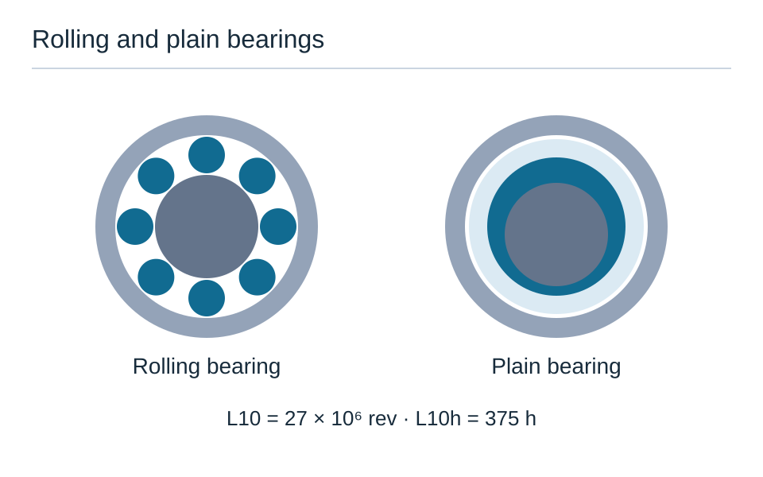

# M8-L3 – Rolling and plain bearings {#L3}

**Course area:** M8 – Machine elements

**Level:** Bachelor

**Prerequisites:** [M8-L2 – Bolts and joints](M8-L2.md)

**Learning objective:** Compare bearing types and calculate basic rolling bearing life.

## Introduction {#S1}

Bearings guide moving parts and transfer loads to the housing. Selection depends on speed, friction, envelope and operating environment as well as loading.

## Foundations, concepts and model {#S2}

Rolling bearings use rolling elements between raceways; plain bearings use sliding surfaces and possibly a load-bearing lubricant film. A locating bearing typically fixes axial position, while a non-locating bearing permits thermal axial expansion. Actual arrangements depend on bearing type and load case.

For constant equivalent dynamic bearing load P and dynamic load rating C, basic rating life is $L_{10}=(C/P)^p$ in millions of revolutions, with $p=3$ for ball bearings and $p=10/3$ for roller bearings. Under model conditions L10 corresponds to 90% survival probability for a group of similar bearings. At constant speed n in rpm, $L_{10h}=10^6 L_{10}/(60n)$. Static capacity, contamination, lubrication and temperature must be assessed separately.

*Rolling and plain bearing cross-sections and nominal bearing life.*

## Worked example {#S3}

Ball bearing: C=30 kN, P=10 kN, n=1200 rpm. L10=3³=27 million revolutions; L10h=27,000,000/72,000=375 h. At P=5 kN basic life rises to 216 million revolutions or 3,000 h.

## Self-assessment {#S4}

### Exercises

1. Does halving speed double basic life in revolutions?
2. Is L10 a guaranteed minimum life for every bearing?

::: {.lc-solutions data-lc-section="S4"}
### Solutions

1. No; only life in hours doubles in the unchanged load model.
2. No, it is a statistical basic rating measure.
:::

## Assumptions and limitations {#S5}

Constant P and n, basic fatigue model; actual bearing selection requires manufacturer data and additional failure criteria.

## Summary and transition {#S6}

Basic rating life is highly sensitive to equivalent load.

**Continue:** [M8-L4 – Gear transmissions](M8-L4.md)

## Sources {#S7}

- [SKF Evolution – The SKF formula for rolling bearing life](https://evolution.skf.com/the-skf-formula-for-rolling-bearing-life/) · Basic life relation and bearing-type exponent · Last accessed: 2026-11-25
- [MIT OCW – Elements of Mechanical Design: Lecture Notes](https://ocw.mit.edu/courses/2-72-elements-of-mechanical-design-spring-2009/pages/lecture-notes/) · Lecture index: shafts, bearings, bolted joints, gears, clutches and brakes; PDFs not individually reviewed · Last accessed: 2026-11-25

