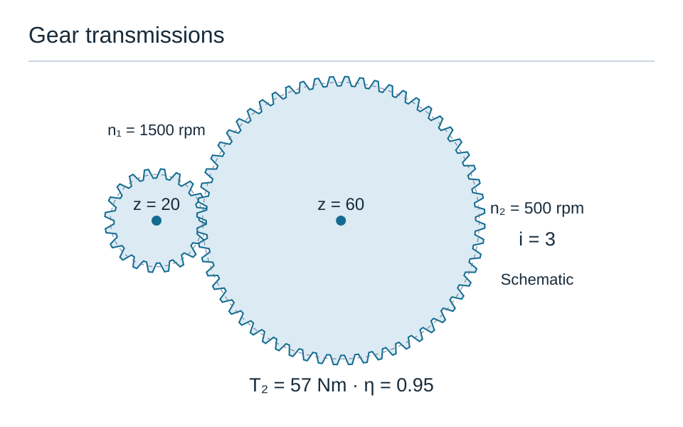

# M8-L4 – Gear transmissions {#L4}

**Course area:** M8 – Machine elements

**Level:** Bachelor

**Prerequisites:** [M8-L3 – Rolling and plain bearings](M8-L3.md)

**Learning objective:** Determine ratio, torque and tooth force of a simple spur gear pair.

## Introduction {#S1}

Transmissions adapt speed and torque to the working process. A gear pair transfers motion through tooth engagement.

## Foundations, concepts and model {#S2}

For two external spur gears the magnitude of the ratio is $i=|n_1/n_2|=z_2/z_1$. Rotation directions are opposite. Module m links pitch diameter to tooth count: $d=mz$. For standard unshifted reference profiles the nominal centre distance is $a=(d_1+d_2)/2$. In steady operation with efficiency $\eta=P_2/P_1$, torque magnitudes obey $T_2=\eta i T_1$.

Tangential tooth force at the driving gear's reference diameter is $F_t=2T_1/d_1$. For an ideal straight involute gear pair the pressure angle $\alpha$ gives a radial component $F_r=F_t\tan\alpha$. Tooth-root stress, contact durability, noise and lubrication require further models. Multi-stage ratios multiply when the power path and sign conventions are unambiguous.

*Spur gear pair with tooth counts, speeds and pitch circles.*

## Worked example {#S3}

z₁=20, z₂=60, m=2 mm, n₁=1500 rpm, T₁=20 Nm, η=0.95. d₁=40 mm, d₂=120 mm, a=80 mm; i=3, n₂=500 rpm in magnitude, T₂=57 Nm. F_t=40/0.04=1,000 N; at α=20°, F_r≈364 N.

## Self-assessment {#S4}

### Exercises

1. What output speed results from a second reduction stage i=2?
2. Does power increase in an ideal reduction gear?

::: {.lc-solutions data-lc-section="S4"}
### Solutions

1. 250 rpm in magnitude.
2. No, torque rises at the expense of speed; ideally power is unchanged.
:::

## Assumptions and limitations {#S5}

Steady operation, simplified force decomposition neglecting mesh friction; overall efficiency is specified separately. No gear strength approval.

## Summary and transition {#S6}

Ratio follows from geometry; losses limit available torque.

**Continue:** [M8-L5 – Springs, clutches and brakes](M8-L5.md)

## Sources {#S7}

- [MIT OCW – Elements of Mechanical Design: Lecture Notes](https://ocw.mit.edu/courses/2-72-elements-of-mechanical-design-spring-2009/pages/lecture-notes/) · Lecture index: shafts, bearings, bolted joints, gears, clutches and brakes; PDFs not individually reviewed · Last accessed: 2026-11-25
- [OpenStax – University Physics 1: Work and Power for Rotational Motion](https://openstax.org/books/university-physics-volume-1/pages/10-8-work-and-power-for-rotational-motion) · §10.8 torque, work and power · Last accessed: 2026-11-25

