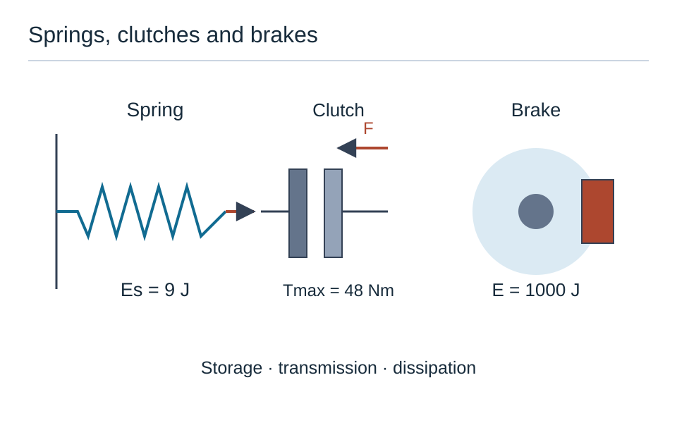

# M8-L5 – Springs, clutches and brakes {#L5}

**Course area:** M8 – Machine elements

**Level:** Bachelor

**Prerequisites:** [M8-L4 – Gear transmissions](M8-L4.md)

**Learning objective:** Distinguish elastic energy and simple friction torque models.

## Introduction {#S1}

Springs store mechanical energy. Clutches connect drives, while brakes slow or hold motion. These components can experience substantial thermal and mechanical loads.

## Foundations, concepts and model {#S2}

For a linear spring, the force magnitude at non-negative displacement magnitude x obeys $F=kx$ and stores $E_s=kx^2/2$ relative to its unloaded position. Real springs may show preload, nonlinear characteristics and fatigue. A friction clutch transfers torque through normal force and friction. For a simplified model with n equally loaded friction interfaces, clamping force F per interface, coefficient $\mu$ and effective radius $r_e$, $T_{max}=n\mu F r_e$. Effective radius depends on pressure or wear distribution.

During slip, heat generation rate is $P_{loss}=T|\omega_1-\omega_2|$. For a brake stopping an isolated rotor without external work input, kinetic energy $E=J\omega^2/2$ is converted to other energy forms, mostly heat. Repeated braking requires a thermal balance and temperature limits.

*Linear spring, friction clutch and brake showing energy transfer.*

## Worked example {#S3}

Spring: k=20 kN/m, x=0.03 m → F=600 N, E_s=9 J. Clutch: n=2, μ=0.3, F=1,000 N per interface, r_e=0.08 m → T_max=48 Nm. With 40 Nm transmitted and 10 rad/s slip, loss power is 400 W. A rotor with J=0.2 kg m² and ω=100 rad/s has 1,000 J of rotational energy.

## Self-assessment {#S4}

### Exercises

1. How does spring energy change at double travel?
2. Why may a slipping clutch overheat?

::: {.lc-solutions data-lc-section="S4"}
### Solutions

1. It quadruples to 36 J.
2. Relative angular speed at transmitted torque produces continuous heat generation.
:::

## Assumptions and limitations {#S5}

Constant friction coefficients, idealised contact distribution, linear spring; not the design of a safety-critical brake.

## Summary and transition {#S6}

Force and torque capacity must be considered together with energy and heat.

**Continue:** [M8-L6 – Tribology and lubrication](M8-L6.md)

## Sources {#S7}

- [OpenStax – University Physics 1: Potential Energy of a System](https://openstax.org/books/university-physics-volume-1/pages/8-1-potential-energy-of-a-system) · §8.1 ideal spring energy · Last accessed: 2026-11-25
- [MIT OCW – Elements of Mechanical Design: Lecture Notes](https://ocw.mit.edu/courses/2-72-elements-of-mechanical-design-spring-2009/pages/lecture-notes/) · Lecture index: shafts, bearings, bolted joints, gears, clutches and brakes; PDFs not individually reviewed · Last accessed: 2026-11-25
- [OpenStax – University Physics 1: Work and Power for Rotational Motion](https://openstax.org/books/university-physics-volume-1/pages/10-8-work-and-power-for-rotational-motion) · §10.8 torque, work and power · Last accessed: 2026-11-25

