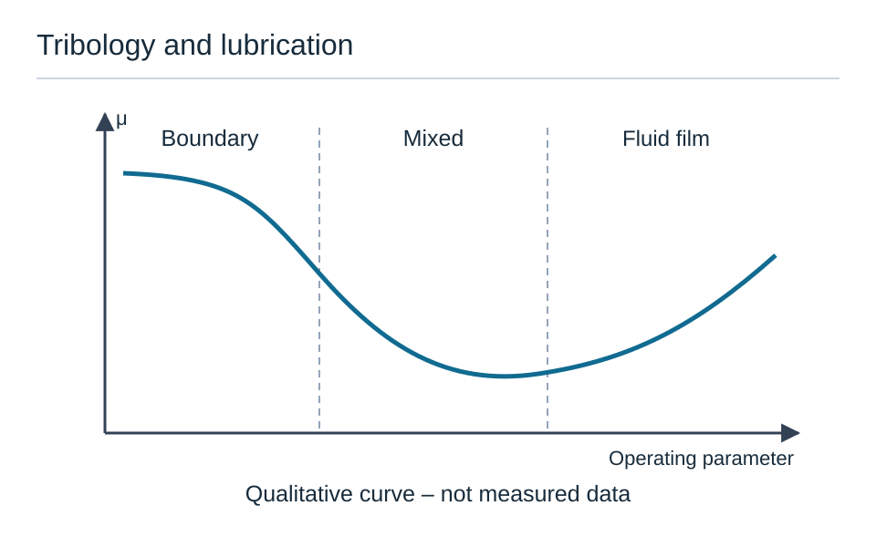

# M8-L6 – Tribology and lubrication {#L6}

**Course area:** M8 – Machine elements

**Level:** Bachelor

**Prerequisites:** [M8-L5 – Springs, clutches and brakes](M8-L5.md)

**Learning objective:** Distinguish friction, wear and lubrication regimes and estimate frictional losses.

## Introduction {#S1}

Tribology studies interacting surfaces in relative motion. A low friction coefficient alone guarantees neither low wear nor reliable operation.

## Foundations, concepts and model {#S2}

In a simple Coulomb model sliding friction is $F_R=\mu F_N$ and dissipated power is $P_R=F_Rv$. In actual contacts the friction coefficient depends on material, surface condition, temperature, lubrication and speed. Adhesive and abrasive wear involve different mechanisms; fatigue of repeatedly loaded contacts is another damage route.

In boundary lubrication the surface carries a substantial portion of the load. Under mixed lubrication, asperities and lubricant film share the load; with full fluid-film lubrication, the film largely separates the solids. The qualitative Stribeck curve plots friction coefficient against an operating parameter typically increasing with viscosity and speed and decreasing with specific load. The precise parameter depends on contact geometry. At high film contribution, viscous shear may increase friction again.

*Schematic Stribeck curve with boundary, mixed and fluid-film lubrication.*

## Worked example {#S3}

F_N=2,000 N, v=0.5 m/s. At μ=0.12, F_R=240 N and P_R=120 W; at μ=0.03, F_R=60 N and P_R=30 W. Simplified loss falls by 90 W or 75%.

## Self-assessment {#S4}

### Exercises

1. Does friction power double at twice v in the constant Coulomb model?
2. Does low μ prove a durable load-bearing lubricant film?

::: {.lc-solutions data-lc-section="S4"}
### Solutions

1. Yes; in a real contact μ may also change.
2. No; film condition, temperature and wear need separate assessment.
:::

## Assumptions and limitations {#S5}

Schematic curve without calibration; check load, speed, temperature, material compatibility and manufacturer specifications before actual lubricant selection.

## Summary and transition {#S6}

Tribological design optimises the complete contact system, not just one friction coefficient.

**Continue:** [M9-L1 – Casting and forming](M9-L1.md)

## Sources {#S7}

- [MIT OCW – Tribology: Syllabus](https://ocw.mit.edu/courses/2-800-tribology-fall-2004/pages/syllabus/) · Course overview: friction, wear and lubrication · Last accessed: 2026-11-25
- [MIT OCW – Tribology: Lecture Notes](https://ocw.mit.edu/courses/2-800-tribology-fall-2004/pages/lecture-notes/) · Lecture index: friction, wear, lubrication · Last accessed: 2026-11-25
- [OpenStax – Work-Energy Theorem](https://openstax.org/books/university-physics-volume-1/pages/7-3-work-energy-theorem) · §7.3 work and kinetic energy · Last accessed: 2026-11-25

