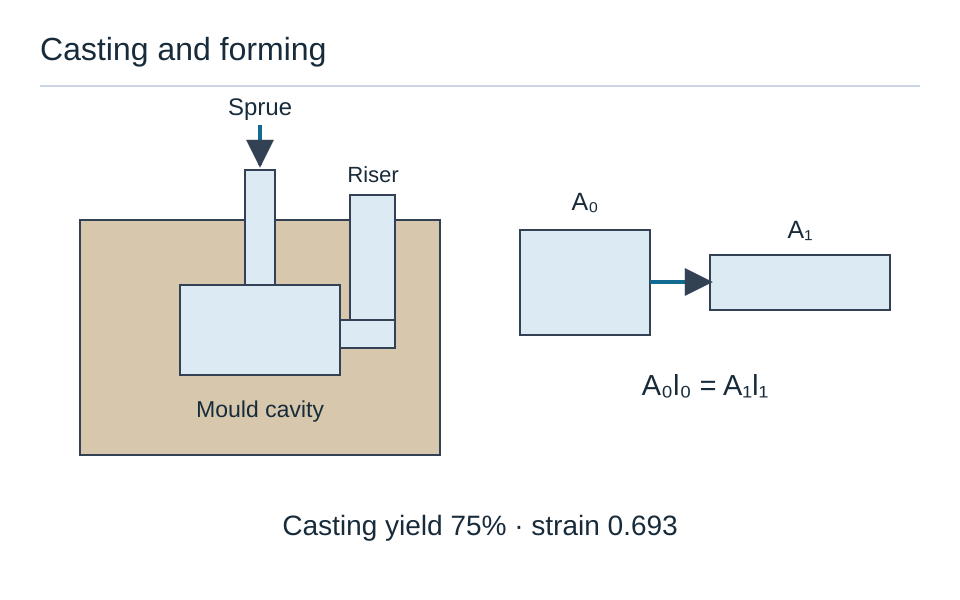

# M9-L1 – Casting and forming {#L1}

**Course area:** M9 – Manufacturing and production

**Level:** Bachelor

**Prerequisites:** [M1-L1 – Units, scaling and dimensional analysis](M1-L1.md)

**Learning objective:** Distinguish primary shaping from forming and calculate material yield and deformation strain.

## Introduction {#S1}

A housing can be cast from a melt or shaped from an existing solid blank. The choice affects microstructure, surfaces, tolerances and cost.

## Foundations, concepts and model {#S2}

Primary shaping creates a solid body from initially shapeless material. In casting, a melt fills a mould cavity; solidification and shrinkage must be accommodated. Risers can supply additional liquid metal and vents allow gas to escape. Porosity and shrinkage cavities compromise strength. Moulds may be expendable (sand casting) or reusable (permanent-mould casting). Casting yield is $\eta_m=m_{part}/m_{charge}$; returned material is not automatically waste.

Forming largely preserves material cohesion. Rolling, forging, extrusion and deep drawing exploit plastic flow; compressive and tensile stresses depend on the process. Cold working often raises strength through work hardening, while hot working can reduce flow stress. Under ideal volume conservation, $A_0l_0=A_1l_1$. Logarithmic longitudinal strain is $\varphi=\ln(l_1/l_0)$, distinct from engineering strain.

*Casting with sprue and riser and plastic deformation of a billet.*

## Worked example {#S3}

A casting weighs 6 kg and needs 8 kg of metal including sprue and risers. Yield is 6/8 = 75%. An ideally formed bar with A₀ = 200 mm² and l₀ = 100 mm is reduced to A₁ = 100 mm². Thus l₁ = 200 mm and φ = ln(2) = 0.693.

## Self-assessment {#S4}

### Exercises

1. What yield results from a 5 kg part made from 8 kg charge?
2. Why cannot risers simply be omitted?

::: {.lc-solutions data-lc-section="S4"}
### Solutions

1. 62.5%.
2. They can compensate for volume loss during solidification.
:::

## Assumptions and limitations {#S5}

Ideal plastic flow without material loss, temperature or friction gradients; tool forces, solidification and defects require more advanced models.

## Summary and transition {#S6}

Primary shaping creates the solid body, forming changes its geometry. Yield alone does not determine process selection.

**Continue:** [M9-L2 – Machining and CNC](M9-L2.md)

## Sources {#S7}

- [MIT OCW – Design and Manufacturing II (2025): Lecture Notes](https://ocw.mit.edu/courses/2-008-design-and-manufacturing-ii-spring-2025/lists/lecture-notes/) · Lecture index 5–12, 16–21 and 23; individual PDFs not reviewed · Last accessed: 2026-11-25

