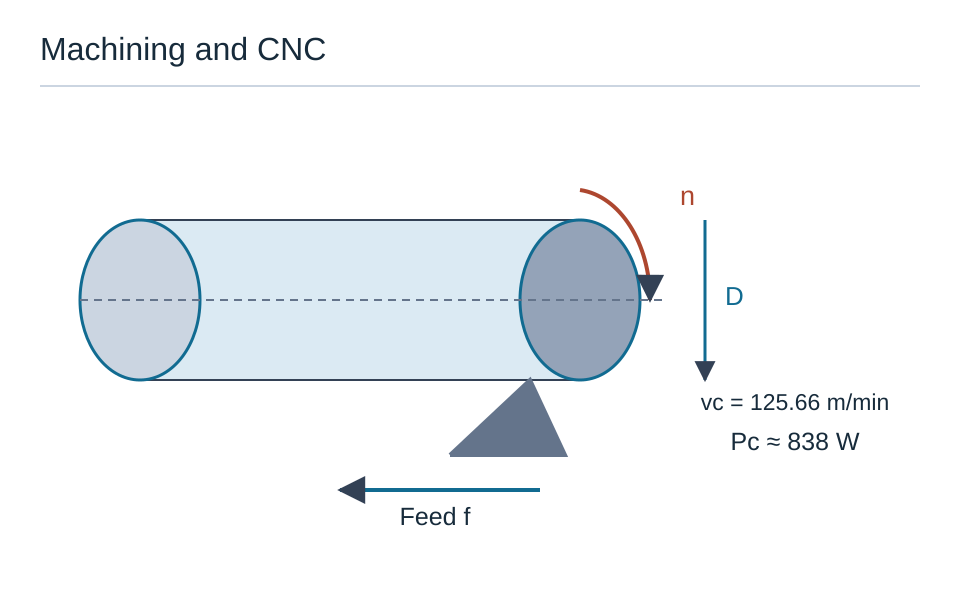

# M9-L2 – Machining and CNC {#L2}

**Course area:** M9 – Manufacturing and production

**Level:** Bachelor

**Prerequisites:** [M9-L1 – Casting and forming](M9-L1.md)

**Learning objective:** Determine cutting speed, spindle speed, feed rate and idealised cutting power.

## Introduction {#S1}

Machining selectively removes material. CNC coordinates movements but replaces neither process planning nor collision verification.

## Foundations, concepts and model {#S2}

In turning, the workpiece usually rotates; milling rotates a multi-edge tool. Tool geometry, chip formation, friction and heat determine wear and surface quality. Cutting speed $v_c=\pi Dn/1000$ uses D in mm, n in rpm and v_c in m/min. In turning, feed rate is $v_f=fn$ with feed f in mm/rev. Cutting power is $P_c=F_cv_c/60$ in W for F_c in N and v_c in m/min. Motor power must account for losses and additional loads.

CAD describes the part; CAM produces toolpaths from geometry, workholding, tooling and machining strategy. A postprocessor translates these paths for the particular controller. Coordinate systems, tool offsets, stock and fixtures must be modelled consistently. Simulation detects some but not all collisions and process problems. Actual setup requires qualified personnel and approved procedures.

*Turning process showing workpiece diameter, feed direction and cutting motion.*

## Worked example {#S3}

For a purely theoretical turning example, D = 50 mm, n = 800 rpm, f = 0.20 mm/rev and F_c = 400 N. v_c = π·50·800/1000 = 125.66 m/min, v_f = 160 mm/min. P_c = 400·125.66/60 = 838 W. These are not operating settings for a real machine.

## Self-assessment {#S4}

### Exercises

1. What happens to v_c if diameter is halved at unchanged spindle speed?
2. What is v_f at 0.1 mm/rev and 800 rpm?

::: {.lc-solutions data-lc-section="S4"}
### Solutions

1. It halves.
2. 80 mm/min.
:::

## Assumptions and limitations {#S5}

Steady idealised quantities; actual values depend on material, tool, cooling, machine and safety limits.

## Summary and transition {#S6}

Cutting kinematics connects geometry and process time; CAM and CNC implement a verified plan.

**Continue:** [M9-L3 – Joining and surfaces](M9-L3.md)

## Sources {#S7}

- [MIT OCW – Design and Manufacturing II (2025): Lecture Notes](https://ocw.mit.edu/courses/2-008-design-and-manufacturing-ii-spring-2025/lists/lecture-notes/) · Lecture index 5–12, 16–21 and 23; individual PDFs not reviewed · Last accessed: 2026-11-25

