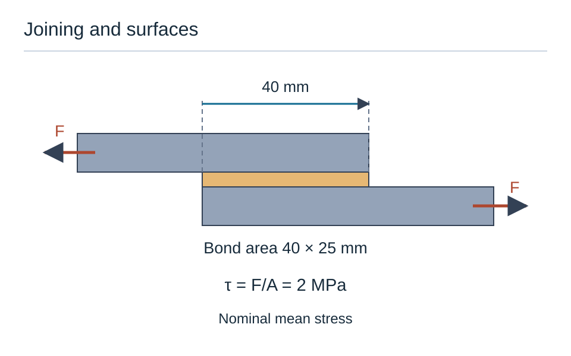

# M9-L3 – Joining and surfaces {#L3}

**Course area:** M9 – Manufacturing and production

**Level:** Bachelor

**Prerequisites:** [M9-L2 – Machining and CNC](M9-L2.md)

**Learning objective:** Compare joining processes by load path and surface requirements.

## Introduction {#S1}

An assembly must transmit loads and may need to be detachable, sealed, electrically conductive or corrosion resistant.

## Foundations, concepts and model {#S2}

Bolts and rivets transmit loads through geometric interlock or friction, depending on the joint and loading. Welding, brazing/soldering and bonding create material bonds. Welding can produce a heat-affected zone with altered microstructure and mechanical properties; brazing and soldering normally melt the filler rather than the base material. Adhesive joints distribute loads over an area but are sensitive to surface condition, ageing and peel loads. Nominal average shear stress is $\tau=F/A$; the actual stress distribution is nonuniform, especially at overlap ends.

Surface processing changes geometry, topography or near-surface properties. Grinding and polishing can reduce roughness, coatings can influence wear or corrosion, and mechanical surface treatment can alter residual stress. Roughness, dimensional accuracy, adhesion and cleanliness are different requirements. Inspection depends on function and consequences of defects, not just visual quality.

*Lap adhesive joint showing nominal shear area and load path.*

## Worked example {#S3}

An adhesive area of 40 × 25 mm carries a nominal shear load of 2 kN. A = 1000 mm² and τ = 2000/1000 = 2 MPa. Relative to a hypothetical comparison value of 6 MPa the ratio is 3; this is not a valid safety assessment because stress concentrations, peel and ageing are omitted.

## Self-assessment {#S4}

### Exercises

1. What does doubling area at the same load yield in the mean-stress model?
2. Why is a shiny surface not sufficient evidence of quality?

::: {.lc-solutions data-lc-section="S4"}
### Solutions

1. Half the average shear stress, namely 1 MPa.
2. Roughness, adhesion, defects and functional properties require appropriate inspection.
:::

## Assumptions and limitations {#S5}

No qualification of a welding, bonding or surface process; real verification requires validated process data and loading-appropriate tests.

## Summary and transition {#S6}

Joining and surface engineering jointly determine design function.

**Continue:** [M9-L4 – Additive manufacturing](M9-L4.md)

## Sources {#S7}

- [MIT OCW – Design and Manufacturing II (2025): Lecture Notes](https://ocw.mit.edu/courses/2-008-design-and-manufacturing-ii-spring-2025/lists/lecture-notes/) · Lecture index 5–12, 16–21 and 23; individual PDFs not reviewed · Last accessed: 2026-11-25

