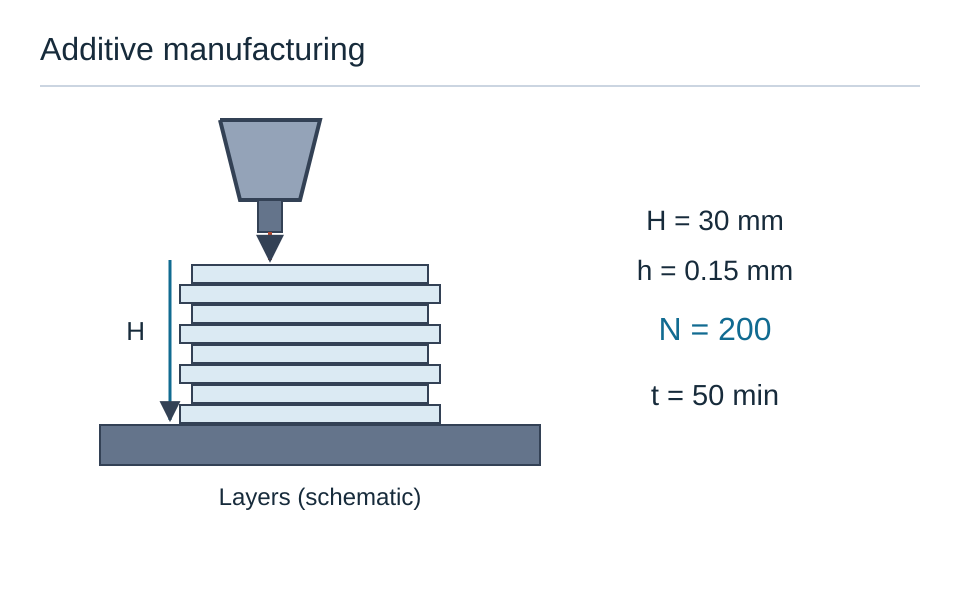

# M9-L4 – Additive manufacturing {#L4}

**Course area:** M9 – Manufacturing and production

**Level:** Bachelor

**Prerequisites:** [M9-L3 – Joining and surfaces](M9-L3.md)

**Learning objective:** Compare additive process families and estimate simplified build time.

## Introduction {#S1}

Additive manufacturing can enable complex geometry but changes the relationship between design, manufacturing and part properties.

## Foundations, concepts and model {#S2}

Material extrusion deposits material through a nozzle. Powder-bed methods consolidate selected regions of a powder layer; directed energy deposition combines material supply and melting. Vat photopolymerisation locally cures a light-sensitive resin. Processes differ in material, resolution, build volume, post-processing and risks. Orientation affects supports, surfaces and directional properties; possession of a CAD model does not guarantee a functional part.

For a part of height H and constant layer thickness h, the geometric layer count is $N=\lceil H/h\rceil$. A rough build-time model is $t=t_0+Nt_s$, where t_s is an assumed average time per layer including layer changes. Real processes have varying cross-sectional areas, path lengths and additional steps such as cooling, support removal, heat treatment and inspection. Critical parts require qualified material and process data.

*Layer-wise deposition and layer counting for a simplified part.*

## Worked example {#S3}

H = 30 mm, h = 0.15 mm, t_s = 12 s and t₀ = 600 s. N = 200, t = 600 + 200·12 = 3000 s = 50 min. At the same average layer time, h = 0.10 mm would produce 300 layers and 70 min.

## Self-assessment {#S4}

### Exercises

1. How many layers are geometrically required for H = 10.1 mm and h = 0.2 mm?
2. Why is layer count alone not a time model?

::: {.lc-solutions data-lc-section="S4"}
### Solutions

1. Rounded up, 51.
2. Layer area, motion, exposure and auxiliary times affect actual build time.
:::

## Assumptions and limitations {#S5}

Model layer times are assumed values, not machine parameters. No substitute for process qualification, occupational or fire safety.

## Summary and transition {#S6}

Additive manufacturing is a family of processes; orientation and post-processing must be included in planning.

**Continue:** [M9-L5 – Process chains and production planning](M9-L5.md)

## Sources {#S7}

- [MIT OCW – Design and Manufacturing II (2025): Lecture Notes](https://ocw.mit.edu/courses/2-008-design-and-manufacturing-ii-spring-2025/lists/lecture-notes/) · Lecture index 5–12, 16–21 and 23; individual PDFs not reviewed · Last accessed: 2026-11-25
- [NIST – Additive Manufacturing Technologies](https://www.nist.gov/additive-manufacturing/research-areas/technologies) · Process families: powder bed fusion, deposition, extrusion, photopolymerization, jetting · Last accessed: 2026-11-25

