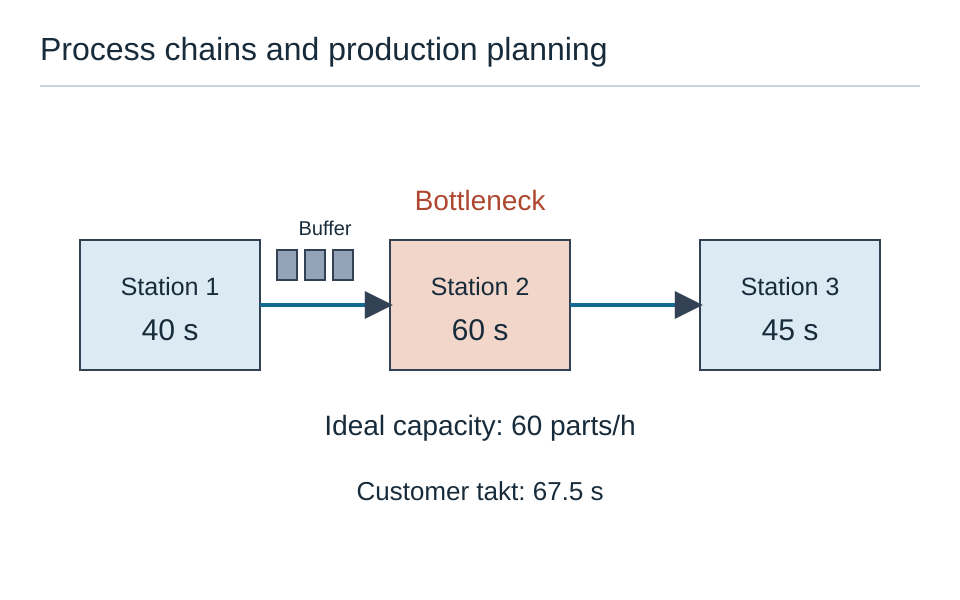

# M9-L5 – Process chains and production planning {#L5}

**Course area:** M9 – Manufacturing and production

**Level:** Bachelor

**Prerequisites:** [M9-L4 – Additive manufacturing](M9-L4.md)

**Learning objective:** Analyse process chains and determine bottleneck capacity and idealised throughput.

## Introduction {#S1}

A fast individual operation does not make a fast production line. Dependencies, availability and material flow matter.

## Foundations, concepts and model {#S2}

Process planning defines operation order, resources, fixtures, inspections and required equipment. A process chain connects those operations. Processing time is active workpiece time; lead time also includes waiting, transport and setup. For serial single stations with no scrap or disruption, the maximum steady rate is $R_{max}=\min_i(1/t_i)$; the longest cycle time t_i limits throughput. Buffers can decouple short-term variation but do not create long-term bottleneck capacity.

Customer takt is available production time divided by demand. It is a planning target, not an automatically achievable processing time. For a stable system, Little's Law is $L=RW$ over the long run, with mean inventory L, throughput R and mean flow time W. System boundaries and time units must match. Setups, disruptions, quality losses and variable demand require more realistic capacity models.

*Three serial manufacturing stations with bottleneck and buffer.*

## Worked example {#S3}

Three stations take 40, 60 and 45 s per part. The ideal bottleneck is station 2: 3600/60 = 60 parts/h. With 7.5 h available and demand of 400 parts, customer takt is 27000/400 = 67.5 s. At an actual throughput of 50 parts/h and mean inventory of 25 parts, W = 25/50 = 0.5 h.

## Self-assessment {#S4}

### Exercises

1. What ideal throughput results if station 2 is reduced to 50 s?
2. Must a buffer be as large as possible?

::: {.lc-solutions data-lc-section="S4"}
### Solutions

1. 72 parts/h; station 2 remains the bottleneck.
2. No. Larger buffers can increase inventory when occupied; at the same throughput, average flow time then increases. Benefits and costs must be balanced.
:::

## Assumptions and limitations {#S5}

Ideal steady capacity without start-up time, disruptions or scrap. Little’s Law uses long-run averages of a stable system.

## Summary and transition {#S6}

Bottleneck, customer takt and lead time are distinct quantities. Production planning must consider them together.

**Continue:** [M9-L6 – Quality and process capability](M9-L6.md)

## Sources {#S7}

- [MIT OCW – Design and Manufacturing II (2025): Lecture Notes](https://ocw.mit.edu/courses/2-008-design-and-manufacturing-ii-spring-2025/lists/lecture-notes/) · Lecture index 5–12, 16–21 and 23; individual PDFs not reviewed · Last accessed: 2026-11-25
- [MIT OCW – Introduction to Manufacturing Systems](https://ocw.mit.edu/courses/2-854-introduction-to-manufacturing-systems-fall-2016/) · Course description: material flow, capacities, bottlenecks and planning · Last accessed: 2026-11-25

