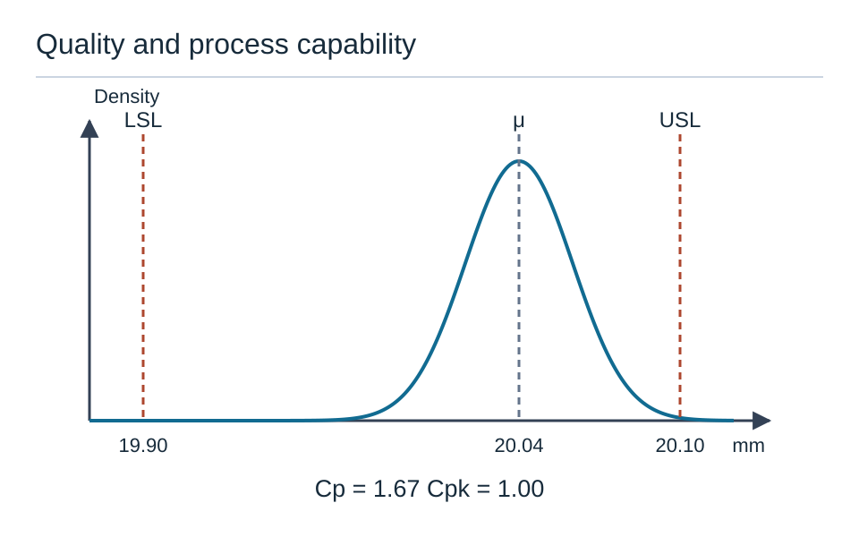

# M9-L6 – Quality and process capability {#L6}

**Course area:** M9 – Manufacturing and production

**Level:** Bachelor

**Prerequisites:** [M9-L5 – Process chains and production planning](M9-L5.md)

**Learning objective:** Distinguish process stability and capability and calculate Cp and Cpk.

## Introduction {#S1}

A shaft may meet tolerance today while its process is not controlled over the long term. Individual inspection and process monitoring have different objectives.

## Foundations, concepts and model {#S2}

Specification limits LSL and USL derive from functional product requirements. Control limits on a statistical process control chart instead derive from process data. A stable process shows no detectable special causes; stability does not automatically mean variation fits the specification. Capability assessment is meaningful only after evaluating stability and the measurement system.

For a sufficiently stable, approximately normal process, indices are estimated using sample mean $\bar x$ and standard deviation s: $C_p=(USL-LSL)/(6s)$ and $C_{pk}=\min[(USL-\bar x)/(3s),(\bar x-LSL)/(3s)]$. Cp compares available tolerance width with variation; Cpk additionally accounts for centring. Both are estimates requiring suitable representative data. Here s estimates variation of the stable process; with subgroups, observe the agreed estimation method, particularly the distinction from overall variation used for Pp and Ppk. Required capability depends on application and quality agreement, not a universal acceptance threshold.

*Normal distribution of a hypothetically stable process with shifted mean and specification limits.*

## Worked example {#S3}

A hypothetically stable process has LSL = 19.90 mm, USL = 20.10 mm, mean = 20.04 mm and s = 0.02 mm. Cp = 0.20/0.12 = 1.67. Cpk = min(0.06/0.06, 0.14/0.06) = 1.00. Variation is relatively small but the shifted mean reduces Cpk.

## Self-assessment {#S4}

### Exercises

1. What is Cpk at a mean of 20.00 mm with unchanged variation?
2. Are control limits the same as specification limits?

::: {.lc-solutions data-lc-section="S4"}
### Solutions

1. 1.67, equal to Cp.
2. No, control limits describe process behaviour, specifications define requirements.
:::

## Assumptions and limitations {#S5}

Normality and stability are model assumptions. Small, dependent or nonnormal samples require suitable alternative analyses and uncertainty statements.

## Summary and transition {#S6}

Process capability relates variation, centring and specification; the measurement chain is part of quality assurance.

**Continue:** [M10-L1 – Measurement chains and uncertainty](M10-L1.md)

## Sources {#S7}

- [MIT OCW – Design and Manufacturing II (2025): Lecture Notes](https://ocw.mit.edu/courses/2-008-design-and-manufacturing-ii-spring-2025/lists/lecture-notes/) · Lecture index 5–12, 16–21 and 23; individual PDFs not reviewed · Last accessed: 2026-11-25
- [NIST/SEMATECH e-Handbook – What is Process Capability?](https://www.itl.nist.gov/div898/handbook/pmc/section1/pmc16.htm) · §6.1.6: Cp, Cpk, estimation and distribution assumptions · Last accessed: 2026-11-25

